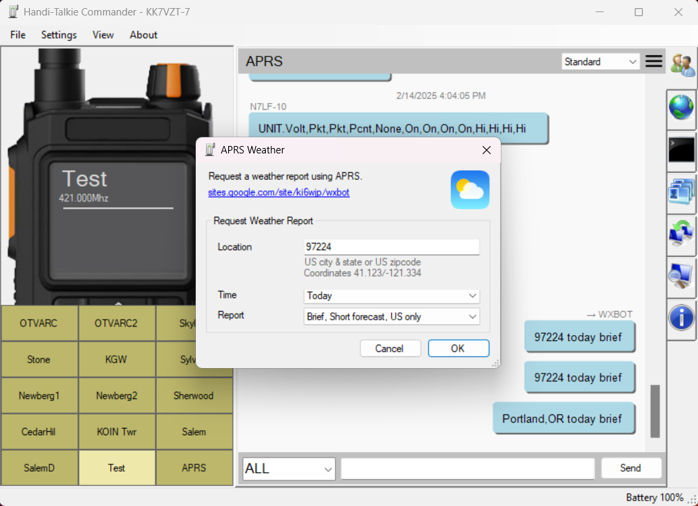

# APRS Weather

If you setup HT Commander with a callsign and allow transmit you can request weather reports for a location and time. Connect to the radio and in the [APRS tab](https://github.com/Ylianst/HTCommander/blob/main/docs/APRS.md), there is a menu on the upper right where you can click "Weather Report...". Then enter the location and select a time and report type. You can get extra information on this service at [WxBot](https://sites.google.com/site/ki6wjp/wxbot).

The **WXBOT-0** (or **WXBOT**) conversation also has a circular command button beside the avatar, like OTA. It offers **Today**, **Tonight**, **Tomorrow**, and **Full forecast** (US only). Selecting an option opens the weather dialog with the matching time and report type, reusing your saved location. You can adjust the location, time, or report before choosing **Use command** to place the request in the composer. Nothing is transmitted until you press **Send**; cancelling preserves your draft. The original APRS menu's **Weather Report...** action still sends on confirmation.