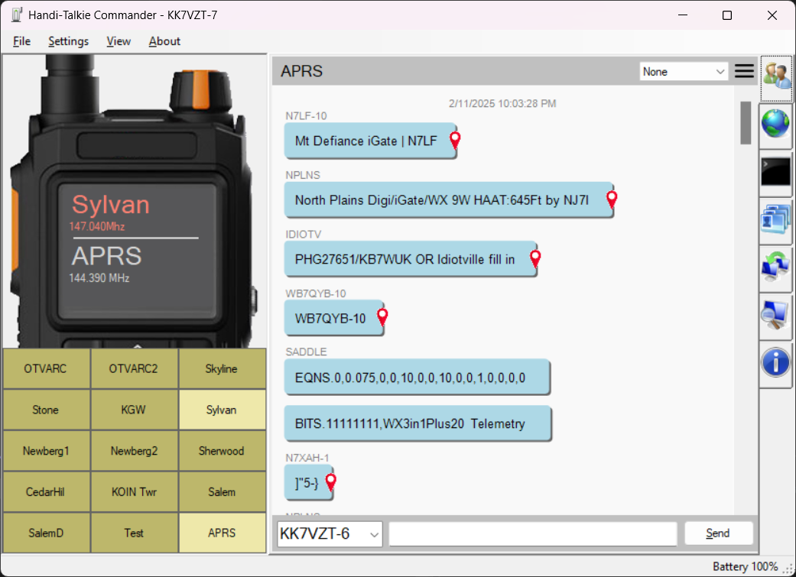

# APRS

The main tab in Handi-Talky Commander is the APRS tab. You can use this tab to see messages from others, send you own message and see a lot of telemetry messages. In general, if you set your radio right, the radio will always monitor the APRS channel even if you doing normal voice monitoring on a different non-APRS channel. So, don't be surprised if you set the radio to your favorite repeater and still see APRS messages coming in. When you send a APRS message out, we tell the radio this is a APRS packet and so, it should be transmitted on the correct frequency. To make this feature work, a channel called "APRS" will need to be setup. If you don't have such a channel, you will get a notice with a dialog box to help you create one.

On the upper right, you can click on the 3 bars to opt to not see telemetry messages. You can also send SMS message to normal phones which is great if you need to send a text message and don't have cell phone access.

## Radio Beacon Channel

In **Radio Settings > Beacon**, select a dedicated channel instead of **Current
(Not Recommended)** to keep the radio's automatic beacons off your voice channel.
The shared Save button saves this selection together with the other radio
settings. The standalone Beacon Settings dialog saves the same setting.

This setting controls the radio's built-in beaconing. App-generated APRS
messages and software beacons still use the channel named **APRS**.

When APRS-IS is connected with a verified login, outgoing APRS messages are
also sent directly to APRS-IS, even when a radio is used. The internet copy
uses `TCPIP*`; the radio copy keeps the selected RF route. Without a radio,
messages can still be sent through APRS-IS alone.

In the "File" -> "Settings" -> "APRS" dialog box, you can add more APRS routes. Once you have more than one route configured, a drop-down box will show up on the upper right of the APRS tab and you can select what route you want to use when sending messages. This allows you messages to hit the digipeaters you want to get your message to the right destination.

APRS telemetry messages will show up on the [map tab](https://github.com/Ylianst/HTCommander/blob/main/docs/Map.md), and you can right click on any APRS message to get extra details or to show a mini-map of the location of the station.

## Reliable outgoing messages

The **APRS outbox** button in the messaging header lists outgoing messages and
their individual parts. Messages are saved before transmission. After restarting
HTCommander, unfinished messages are **paused**: select **Retry / resume** in the
outbox to continue. Hosted browsers and detached windows use the desktop host's
outbox; only the host transmits and retries.

The link selector beside the composer offers **Automatic**, **RF only**,
**Internet only**, and **RF + internet**. It applies to ordinary messages,
SMS and weather-service requests. Automatic preserves the existing behavior:
without a selected radio it uses the internet; with a radio it also permits
internet submission when APRS-IS is enabled at queue time. The resolved policy
is saved with each message and displayed in the outbox. Changing settings,
restarting, reconnecting or resuming never broadens that saved policy.
The composer starts in Automatic in each window.
Update/restart the native owner together with hosted web assets; older native
hosts cannot enforce the new explicit policies.

Explicit RF-only/both requests require an original radio identity. Internet-only
ignores a preferred radio and can wait queued until APRS-IS is enabled and
verified. Only available, permitted links are used; there is no implicit failover
or radio substitution. Both links share a part's ID and logical attempt budget,
not separate retry budgets. HTCommander does not up-gate its own tracked RF
echoes or down-gate its own tracked internet echoes: the outbox owns those
copies and their attempt budget. **RF only constrains this
application, not other independent IGates which may relay received RF traffic.**

- **Queued**: waiting for the original radio or an eligible APRS-IS connection.
- **Submitted**: handed to the radio/network, not proof of RF emission or delivery.
- **Heard via digipeater**: a matching RF copy was heard with a used digipeater path.
- **Acknowledged** / **Rejected**: a matching ACK/REJ from the intended recipient.
  Authenticated messages require an authenticated reply.
- **No acknowledgement**: the retry budget was exhausted; a late ACK can still
  update this state.
- **Paused** / **Stopped**: no automatic retry. Stopping or clearing prevents
  future retries and removes cancellable queued radio copies, but a copy already
  handed to a modem or network can still transmit.

Defaults are **six total attempts**, with waits of **30, 60, 90, 120 and 150
seconds** between them. After the final attempt, a further 180-second reply
window precedes the no-acknowledgement state. The outbox's settings change the
attempt limit and base delay for **new messages**; each wait is capped at five
minutes. An unavailable link does not consume attempts. Automatic RF retries
never switch to a different radio. Retry/resume resets an exhausted or stopped
budget, but keeps the remaining budget of a paused message. Active messages
cannot be retried manually. Up to 1,000 completed logical messages are retained
in the outbox; unfinished messages are not evicted.

The composer shows the ASCII byte count and, when needed, the number of parts.
APRS text has a **67-byte limit**, reduced to **60 bytes** with HTCommander's
seven-byte authentication suffix. Longer messages are split into numbered parts
with distinct message IDs (up to 20 parts); SMS gateway recipient prefixes are
repeated on each part. Only printable ASCII is accepted; braces, vertical bars
and tildes are reserved by APRS. Unsupported text is rejected visibly rather
than silently changed. The draft clears only after the host accepts and saves
the message. Changing authentication requirements pauses retries rather than
silently downgrading authentication.
If queue confirmation is lost, the draft remains and a warning asks you to
check the outbox before resending. Changing the local callsign or disabling
transmit blocks automatic retries. Verified authenticated messages receive
signed ACKs over both RF and APRS-IS.

## Receive observations

Select **Receive observations** from the APRS header menu to inspect the latest
**1,000 observations**, including decoder duplicates. Incoming APRS frames are
observed before the existing global three-second payload deduplication, so two
receiving radios retain separate observations while chat and notifications still
receive a single deduplicated packet.

Records include UTC capture/receive times, radio ID/MAC, channel/region, decoder,
frame type/corrections, original sender and AX.25 frame source, packet content,
path and used-hop bits. A requested WIDE path alone is not a used hop.
Third-party senders, internet copies and loopback observations never count as
direct RF reception. TCPIP/TCPXX and APRS-IS q-construct paths also identify
internet-origin copies received over RF, not direct-heard station evidence.
Outgoing and explicitly historical raw frames do not enter
the live receive journal. Repeated results on the same radio/channel within three
seconds identify the first observation and whether the decoder differs; they do
not claim distinct physical transmissions.

Native observations use the shared SQLite database (schema v8); standalone
browsers use awaited preferences. Hosted browsers mirror the native owner's
journal and never archive locally decoded host traffic. Detached windows use the
same broker-owned journal. Restored archive records are **historical**, not live
events, and are never replayed through message acknowledgements or RF forwarding.
Internet backfill is historical too. Unsaved records and archive errors remain
visible rather than being reported as successfully persisted.

This is the observation foundation, not yet a new direct-heard IGate policy,
station explorer or delayed/cancelable fill-in digipeater.

## Message History

The live tab keeps up to 1,000 RF entries and 1,000 APRS-IS entries independently.
Evicting old entries removes only their bubbles; surviving messages keep stable
IDs and cached content instead of being rebuilt on every new internet packet.
This does not delete the persisted history.

Opening a conversation or the combined feed automatically shows its latest
500 messages, merging retained RF/APRS-IS history in chronological order.
**Read more** appears at the top only when older messages exist for that
specific thread (and the combined feed's current filters). Select it to load
up to 500 more messages inline. Each thread checks its own history; traffic in
other threads does not cause an empty **Read more** button.
Loaded messages stay in chronological order and follow the current conversation,
telemetry and internet-traffic filters. Retransmissions are collapsed as in the
live feed, and cleared messages remain hidden. While browsing stored history,
loaded messages stay available rather than being evicted by new traffic.

The archive also works in detached windows and hosted web clients through the
host. Without a database (including stand-alone web), only the bounded live
window is available. Existing retention settings still govern on-disk history.

## Saving Messages

While a conversation or the "All Messages" view is open, use **Save as CSV...** or **Save as TXT...** from the APRS tab menu to save the messages currently shown (respecting the telemetry and internet-traffic filters). The options are grayed out on the conversation list. The file format is the same as the [Comms tab export](https://github.com/Ylianst/HTCommander/blob/main/docs/Voice.md#exporting-comms-conversations); the type column is `APRS`, `APRS-IS` or `MeshCore`.

Extra APRS Features:
- [APRS SMS](https://github.com/Ylianst/HTCommander/blob/main/docs/APRS-SMS.md)
- [APRS Weather](https://github.com/Ylianst/HTCommander/blob/main/docs/APRS-Weather.md)