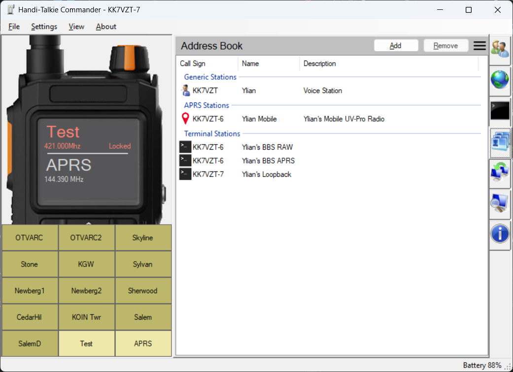

# Address Book

Handi-Talky Commander has a built-in address book. This is currently useful to keep a list of [APRS](https://github.com/Ylianst/HTCommander/blob/main/docs/APRS.md) stations you quickly want to select, or [terminal](https://github.com/Ylianst/HTCommander/blob/main/docs/Terminal.md) profiles you want to use. In the future, more could be done with this but it seems like a basic feature to make everything else in the application work better.

In the Contacts tab, select one or more contacts and press **Delete** to remove them. This opens the same confirmation dialog as the **Remove** button; contacts are only removed after confirmation.

Terminal/BBS and Winlink contacts store a station frequency in MHz rather than a channel name or region. Enter the frequency directly, or use the channel-picker button beside the frequency input to copy a connected radio channel's frequency. When connecting with a saved frequency, HTCommander checks the radio's current channels for an exact receive/transmit frequency match with no offset and no receive or transmit tone. It uses a matching channel if available; otherwise it switches directly to Frequency mode without creating a channel. Contacts added from the Winlink map start with the gateway's first listed frequency, which can be edited before saving. Older channel-only contacts continue to work; opening one in the contact editor fills in its frequency when its channel is available on a connected radio, and saving removes its old channel reference.
