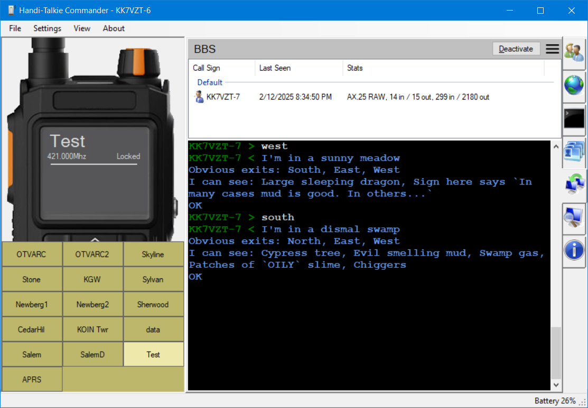

# Bulletin Board System (BBS)

Handi-Talky Commander has a built-in BBS, a bit like the old modem days. This option is only available if you have a HAM radio license and you enabled the application to transmit. It's super easy to activate, just select a channel on the main or top channel and hit "Activate" on the top right of the BBS tab.

The BBS supports AX.25 sessions along with RAW AX.25, APRS and compressed packet formats right now. These are the same protocols the [terminal](https://github.com/Ylianst/HTCommander/blob/main/docs/Terminal.md) supports. An incoming packet needs to be directed at the station and the BBS will reply in the same packet format as it was received. The AX.25 session and APRS format has relay/ack support, RAW AX.25 does not.

Right now, the BBS acts as a private Winlink email gateway and has as support for a text adventure game called [The Adventurer](https://github.com/TheTextAdventurer/Adventurer). Any unconnected packets sent to the BBS will initiate the adventure and the adventure game is saved at each turn using the sender's callsign, so, many stations can play at the same time and each will see their own game. You can transmit "quit" at anytime to restart the game.

The BBS tab will show statistics in real-time on what stations are using the BBS and how many bytes and packets have been sent and received.

Disabling the BBS immediately drops its AX.25/XARA sessions and Winlink gateway connections, clears queued transmissions for that radio, and cancels active audio transmission. No disconnect handshake or final BBS message is sent. Incoming packets cannot restart the disabled BBS; enabling it again starts fresh sessions. Data already handed to the radio or transmitted over the air cannot be recalled.

## XARA (VARA FM compatible) sessions

When **XARA** is selected as the software modem (and the radio audio is enabled), the BBS also answers incoming XARA connections, so stations running VARA FM can use the menu and exchange Winlink mail just like over an AX.25 session (including relay to the Winlink CMS gateway). XARA stations can connect to your callsign with or without your station ID as the SSID (e.g. `N0CALL` or `N0CALL-1`). AX.25 packets carried by XARA are delivered to the BBS as usual. The BBS serves one connected station at a time; a second station connecting over AX.25 or XARA while another session is active is told the BBS is busy and disconnected. XARA connections show as "XARA" in the statistics.

Each incoming AX.25 connection keeps the modem encoding used by the connecting station for all replies, including the connection handshake and disconnect. For example, a 1200-baud packet connection received by the radio's hardware TNC is answered using hardware AFSK 1200 even when XARA is selected globally. The global modem setting is not changed, and incoming XARA connections still use XARA.

XARA session traffic (connect requests, control codes such as ACKs and connect replies, and data frames, including ones that failed their CRC) is shown in the packet capture tab so you can follow a connection attempt. Like DART, the modem column describes how each frame was sent, e.g. "Software XARA FM Narrow Level 5 (8PSK, 58 carriers, LDPC 2/3, 4252 bps), Session, SNR 18.4 dB, 3 LDPC iterations". The decode panel adds the frame's position in its burst, lead-in and burst airtime for sent frames, SNR, Es/N0, LDPC iterations, coherence and airtime for received frames, the session state, and the decoded frame header (payload, compression, last frame, level offer, lead report).
