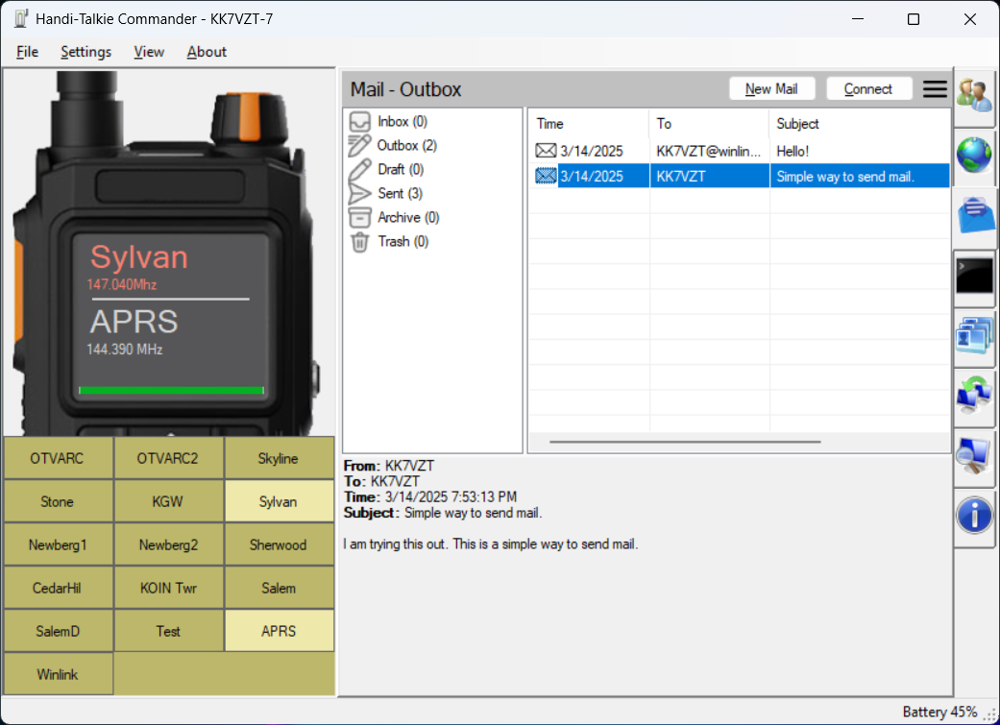

# Mail

Handi-Talky Commander has built-in support for WinLink. You can send and receive emails when contacting any packet radio email gateways. Then checking or sending emails, the radio with switch to the frequency of the Winlink gateway, sync-up and return back when it's done. You can compose and read emails within the application and add, save or drag & drop attachements making authoring easy.

To use this feature, you will need to setup your Winlink account on [Winlink.org](https://winlink.org) and find your nearest gateway. You will also need to enter your Winlink password in the Handi-Talky Commander settings panel to correctly authenticate.

You can also sync mail directly from the Map tab: turn on **Show Winlink Gateways**, select a gateway and press **Sync mail**. The sync runs on the gateway's frequency without adding it to your contacts. See [Offline Winlink Gateway Directory](Winlink-Gateways.md) for details.

## Local Storage

Native builds store mail incrementally in the application's SQLite database.
Metadata and binary attachments are separate: changing read flags or moving a
message no longer base64-encodes and rewrites every attachment in the mailbox.
Unchanged attachment rows are not rewritten. Bursts of edits share a 150 ms
save window; backgrounding and clean shutdown explicitly drain pending saves.

Database upgrades reuse existing mail tables and the original-text history
column when present, even if the recorded schema version is older. Existing
mail, binary attachments, import state, and history are preserved; no database
deletion or reset is required.

Existing `HTCommander/mails.txt` mail is imported once. The legacy file remains
as a backup and is not re-imported after messages have been deleted. JSON mail
backup/restore remains compatible. If the application database is unavailable,
the legacy file path uses coalesced worker-side serialization and a temporary
file rename instead. Persistence failures are reported in diagnostics and
failed writes remain pending for an explicit retry.

## Desktop email clients (local SMTP / POP3)

On Windows, macOS, and Linux, **Settings > Servers** can enable local SMTP and
POP3 servers independently. Both are **disabled by default**. SMTP defaults to
port **8025**, POP3 to **8110**; both ports are configurable. Changes take effect
when you save settings and enabled servers restart with the app.

Configure a separate Winlink account in a direct-connection email client such
as Thunderbird or Apple Mail:

| Setting | Value |
| --- | --- |
| Email address / username | `CALLSIGN@winlink.org` |
| Incoming server | POP3, `127.0.0.1`, port `8110` (or your configured port) |
| Outgoing server | SMTP, `127.0.0.1`, port `8025` (or your configured port) |
| Connection security | None, for both servers |
| Authentication | Normal password; enable outgoing SMTP authentication |
| Password | The **mail bridge password** in Settings > Servers, not your Winlink password |

Enabling either server generates a bridge password if none is configured.
Use the copy button to paste it into your email client. Changing the password
disconnects existing clients. If **Use station ID** is enabled for Winlink, use
the suffixed callsign (for example `CALLSIGN-7@winlink.org`).
The bridge password is kept in the platform's encrypted secret store and is
not synchronized to hosted browsers or agents.

The servers bind **only to IPv4 loopback**. Use `127.0.0.1`, not a LAN address;
there is no TLS, LAN access, or internet relay. HTCommander must remain running.
Mobile and browser builds do not expose this feature. Cloud-mediated clients
that connect from a provider's servers cannot reach this local account.

SMTP saves accepted mail durably into HTCommander's **Outbox**. Click **Connect**
in the Mail tab or **Sync mail** on a Winlink gateway to transmit it. Sending from
the email client does not automatically key the radio or initiate a Winlink
session. The client's Sent folder means *accepted into HTCommander*, not
necessarily transmitted through Winlink.

Use plain-text composition, or multipart mail containing a plain-text part.
MIME attachments, encoded subjects, and character sets are supported; HTML-only
messages and Bcc are explicitly rejected rather than silently losing content or
exposing hidden recipients. Sender addresses must match your configured Winlink
account. Messages are limited to 10 MiB, and subjects to 252 UTF-8 bytes.

POP3 exposes only **Inbox**, with stable message identifiers and a snapshot per
login. Set your client to **leave messages on the server** to retain them in
HTCommander. A POP3 deletion takes effect only on a successful `QUIT`, moving
the message to **Trash**, not permanently deleting it. Disconnecting before
`QUIT` or issuing `RSET` cancels pending deletions. Only one POP3 client may hold
the maildrop at a time. POP3 does not synchronize folders or read/unread flags.
