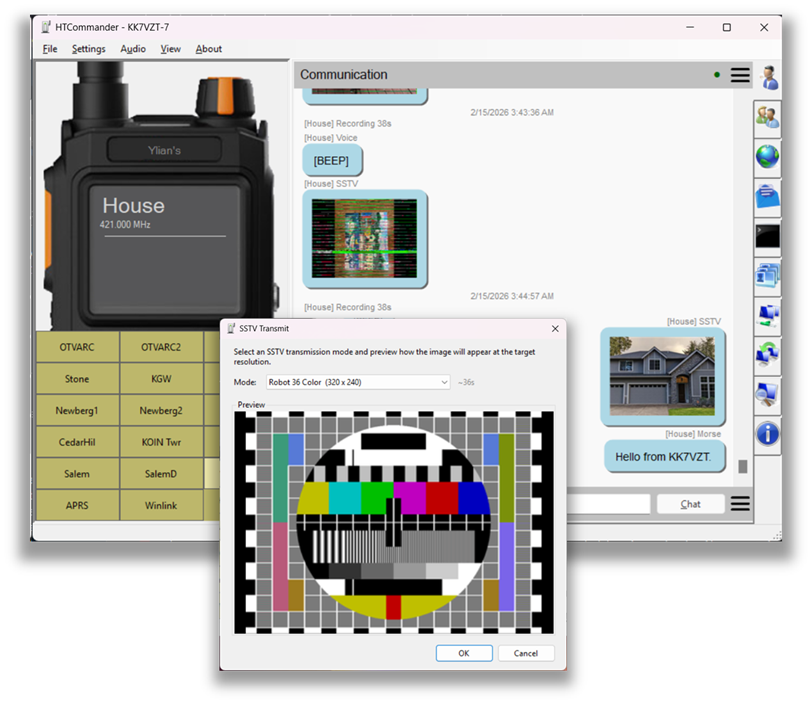

# Slow-Scan Television (SSTV)



Handi-Talky Commander has built-in support to transmit and receive SSTV with a wide range of supported formats including Robot36.

On the receive side, incoming SSTV transmissions are automatically detected and will show up on the "Communication" tab as the image is received. Once received, double click on the image to have a larger view of it.

## Receive performance

Windows, Linux, macOS, and Android builds automatically use a native C++
receive DSP engine. Mixing, FIR filtering, FM demodulation, and sync-pulse
detection run in one native call per audio block, with reusable buffers and
streaming state. The FIR uses double-precision SSE2 on x64 and NEON on ARM64,
with a portable scalar implementation for other architectures. No optional CPU
instruction sets are required.

Mode/VIS detection, scan-line decoding, image rendering, and receive events
continue to use the existing Dart implementation. Web and iOS retain the Dart
DSP path. Resetting, completing, or disposing a receiver releases its native
state; a finalizer also protects abandoned decoders.

For comparison or troubleshooting, build with `--dart-define=HT_SSTV_DART=true`
to use the original Dart DSP, or `--dart-define=HT_SSTV_SCALAR=true` to disable
SIMD without disabling the native engine.

From `src`, run the differential tests and the complete-image benchmark:

```powershell
flutter test test\sstv_native_test.dart
dart run benchmark\sstv_receive_benchmark.dart
```

The benchmark decodes a complete Robot 36 transmission at 32 kHz in 128-sample
blocks, verifies completion, discards a warm-up run, and reports the median of
three runs for Dart, native scalar, and native SIMD. Performance depends on the
CPU, architecture, and Dart compilation mode.

An initial Windows x64 AOT run measured 0.227 seconds for
Dart, 0.218 seconds for native scalar, and 0.103 seconds for native SSE2: about
2.2x faster than Dart for the complete receive pipeline. ARM64 NEON performance
has not yet been measured.

### Receive hot-path tuning

The SSE2 filter now prepares real/imaginary coefficient pairs once, avoiding
a coefficient broadcast for every tap of every sample. The coefficient data
grows by one double per tap (520 bytes at 32 kHz). Scalar and NEON coefficient
layouts are unchanged; no newer instruction set is required.

Audio blocks that fit strictly inside the scan-line history buffer use a bulk
typed-data copy instead of a per-sample Dart loop. Blocks that reach or cross
the boundary retain the original shifting path, including sync-index
adjustments. Tests cover exact fills, crossings with stereo input, and large
blocks requiring multiple shifts before a complete image.

Repeated paired Windows x64 AOT runs at 32 kHz measured:

| Complete Robot 36 processing | Before | After |
| --- | ---: | ---: |
| Native SIMD decoder, with scope | 103 ms | 96 ms |
| PCM image monitor | 108.32 ms | 98.21 ms |

These are medians across five decoder and four monitor benchmark invocations;
each invocation itself discards a warm-up and takes the median of three runs.
Shared-machine load caused some variation. This is roughly 7% less decoder
processing time and 9% less monitor processing time, not a receive-memory
reduction. Floating-point reduction order, per-sample oscillator normalization,
and the existing `1e-10` differential tolerance are preserved.

### Receive memory

The always-on image monitor no longer allocates or renders an unused scope.
It also starts with an empty image buffer and allocates pixels only after VIS
identifies the image dimensions. Standalone `Decoder` users can still supply a
scope buffer; passing `null` disables only scope output, not detection.

Removing the two speculative 800x616 pixel buffers eliminates 3,942,400 bytes
(3.76 MiB) of idle pixel storage per receiver. During Robot 36 reception, pixels
require 320x240 storage instead, saving about 3.47 MiB versus the previous
scope-plus-image allocation. A retained-buffer audit across 16 Dart-to-JavaScript
decoders confirmed at least the expected idle saving.

PCM input reuses a conversion buffer for normal packets, avoiding about
14.6 MiB/minute of temporary sample storage during continuous 32 kHz reception.
Retained conversion capacity is capped at 4096 samples (32 KiB); larger inputs
use temporary storage rather than permanently growing the pool.

Completed images transfer their exactly-sized pixel buffer to the completion
event before a fresh decoder is created. They remain independent of later
images and resets. Partial previews still receive their own snapshot buffer,
so asynchronous PNG encoding cannot see subsequent decoder writes; only the
undecoded tail is filled with opaque black.

The receive-memory changes alone left full-monitor AOT processing time
approximately unchanged on the tested x64 machine (about 103-105 ms for a
complete Robot 36 transmission); the later hot-path tuning above improves CPU
time separately.
The benchmark also measures repeated partial-image snapshots, whose timings
can vary with garbage collection:

```powershell
flutter test test\sstv_monitor_test.dart
dart run benchmark\sstv_monitor_benchmark.dart
```

## Encoder performance

The same native platforms also encode all 16 supported modes in C++, including
HF Fax. Image scaling, RGB/YUV conversion, VIS headers, scan-line timing, and
phase-continuous waveform generation run in one native call. Scan-line storage
is reused, output is sized once, and each pixel's frequency increment is
calculated once for its run of samples instead of once per sample.

SSE2/NEON evaluate pairs of sine samples using a double-precision polynomial
after range reduction. The native scalar path uses the platform sine function.
Differential tests compare every waveform sample against Dart, with an absolute
error bound of `1e-9`; PCM comparisons allow at most one 16-bit quantization step.
Encoder phase continuity, reset, all mode lengths, and decoded PCM images are
also tested. ARM64 NEON has not yet been benchmarked on hardware.

Transmission now calls `Encoder.encodePcm16` directly in the existing background
isolate. This avoids the full floating-point audio intermediate and a Dart
sample-conversion loop, while keeping the existing two-second silence prefix.
The float-returning encoder API remains available. Web/iOS use the Dart encoder.

On the Windows x64 development machine, median AOT results at 32 kHz were:

| Mode | Dart PCM16 | Native SIMD PCM16 | Speedup |
| --- | ---: | ---: | ---: |
| Robot 36 | 87.94 ms | 15.86 ms | 5.5x |
| PD 290 | 708.12 ms | 117.00 ms | 6.1x |

PD 290 PCM output occupies 17.80 MiB (including silence), versus 70.71 MiB for
the float waveform alone, before counting the Dart growable sample list.
Native PCM generation does not allocate that float waveform.

Use `--dart-define=HT_SSTV_ENCODER_DART=true` to select the original encoder
independently of receive DSP. `HT_SSTV_SCALAR=true` disables SIMD for both paths.

```powershell
flutter test test\sstv_encoder_test.dart test\sstv_native_test.dart
dart run benchmark\sstv_encode_benchmark.dart
```

The encoder benchmark includes a warm-up and reports the median of three runs.
It covers float and direct PCM output, native scalar, and native SIMD.

The encoder also fuses SIMD sine evaluation with PCM clipping, rounding, and
little-endian packing instead of writing sine results back to a temporary
double buffer. Float output is written directly too. Native encoder scratch
storage uses a malloc-backed arena rather than clearing buffers before
overwriting them; all payload bytes are written by the encoder, and the silence
prefix is still explicitly zeroed.

Back-to-back AOT runs measured about 25-27% less PCM encoding time than the
previous native implementation:

| Mode | Previous native PCM16 | Fused native PCM16 |
| --- | ---: | ---: |
| Robot 36 | 21.33 ms | 15.86 ms |
| PD 290 | 158.02 ms | 117.00 ms |

This reduces memory traffic, not the size of the returned audio buffer. Tests
also cover bipolar full-scale samples, odd-length SIMD tails, unaligned output
after a silence prefix, and PCM agreement within one quantization step.

### Output ownership and peak memory

Completed native audio is returned as a typed-data view of its allocation,
instead of copying the entire waveform into a second Dart buffer. A native
finalizer releases the allocation when the returned data and its buffer views
are no longer reachable; callers do not need to dispose it. Failed encodes free
their output immediately. Tests cover retained float/PCM views, subsequent
encodes and resets, and output views surviving the encoding isolate's exit.
Web/iOS fallback behavior is unchanged.

Fresh-process Windows x64 AOT measurements for PD 290 at 32 kHz:

| Output | Previous peak RSS | Ownership-transfer peak RSS | Output size |
| --- | ---: | ---: | ---: |
| PCM16, including two-second silence | 49.66 MiB | 31.93 MiB | 17.80 MiB |
| Float | 155.46 MiB | 84.83 MiB | 70.71 MiB |

These are whole-process peak resident-memory measurements, not just output
sizes. Removing the duplicate allocation saved approximately one output
buffer's worth of peak memory; the returned waveform itself has not shrunk.
In repeated paired timing runs, native float encoding improved from about
15-16 ms to 13 ms for Robot 36 and 117-125 ms to 100-103 ms for PD 290.
PCM timings varied, so no additional PCM throughput improvement is claimed.

The benchmark's memory options encode only native PD 290, without first
allocating the Dart reference waveform. Run each option in a fresh process;
the measurements above used AOT:

```powershell
dart build cli --target benchmark\sstv_encode_benchmark.dart --output build\sstv_encode_benchmark
.\build\sstv_encode_benchmark\bundle\bin\sstv_encode_benchmark.exe --memory-pcm
.\build\sstv_encode_benchmark\bundle\bin\sstv_encode_benchmark.exe --memory-float
```

### Other opportunities investigated

Symmetric receive FIR tap folding was implemented and measured, including a
compile-time-specialized version. Both were slower on the tested x64 machine
(about 111 ms versus 103 ms for the existing SIMD receive pipeline), so the
original faster implementation was retained.

Periodic receive oscillator normalization was also tested. Long, low-amplitude
streams slightly exceeded the existing `1e-10` normalized-frequency error
tolerance, so per-sample normalization was retained rather than weakening the
accuracy requirement.

Remaining receive candidates include anti-aliased input decimation and native
scan-line filtering/color conversion. These are not enabled: decimation needs
noisy-signal and sync-timing validation, while native scan-line work needs
profiling to establish its benefit.

## Transmitting

To transmit an image you can drag & drop a PNG, JPEG, BMP into the "Communication" tab or go in the communication tab and select "Image..." from the context menu on the bottom right to select an image. Once an image is selected, you will see a dialog box that will confirm what image will be trasmitted and allows you to select what protocol you want to use.

Note that is seems the radio has a transmit limit of 60 seconds and so, image formats that take longer than 60 seconds will fail to fully transmit. Not sure if this limit can be fixed or not so, the safe bet is to use Robot36.