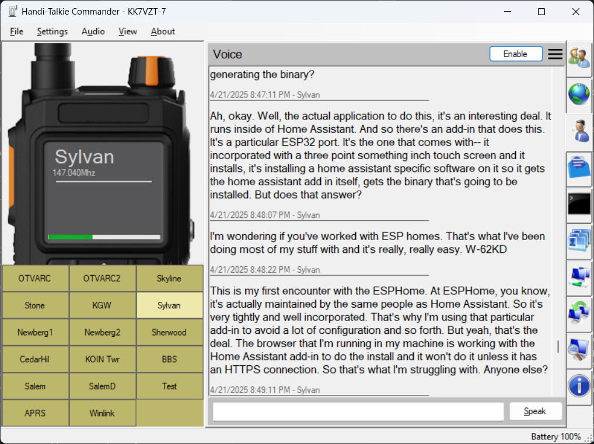

# Voice

HTCommander transcribes received radio speech locally on Windows, macOS, Linux,
and supported Android devices. **Web and iOS do not support radio audio streams
and have no local speech-to-text engine or model controls.** Hosted web clients
can still display transcripts produced by the desktop host.

Desktop recognition uses sherpa-onnx in a background isolate. In **Settings >
Voice**, choose and download SenseVoice (English, Chinese, Japanese, Korean and
Cantonese), Whisper Tiny/Base English, or streaming Zipformer English. Zipformer
shows live partial text; batch models update after speech pauses. Audio is
processed in memory, independently of the optional WAV recording feature.

### Speech detection and transmission boundaries

Desktop model downloads include a shared Silero VAD model (about 629 KiB). If an
existing recognition model is installed without VAD, click **Download** again:
only the missing VAD is fetched, not the full recognition archive. Initialization
never downloads models automatically or silently falls back to ungated audio.

Silero uses a conservative 0.35 threshold, 64 ms minimum speech, and 650 ms
silence endpointing, with approximately 320 ms pre-roll. These are starting
values, not guarantees for weak or noisy radio signals. Speech-free stretches
do not reach the recognizer. Internal chunks are capped at approximately
26 seconds; forced splits retain audio overlap and reconcile matching boundary
words. All utterances remain in **one bubble per radio transmission**.

Each transmission has its own ID, radio, channel and start time. Delayed final
results update that transmission's bubble without overwriting a newer one.
Provisional history entries are persisted only after finalization; disabling
recognition and shutdown allow up to ten seconds for pending finals, then log a
timeout and preserve available partial text.

Android 13+ uses the OS on-device recognizer with a PCM pipe and OS-managed
language models. It retains the OS's segmented-session speech endpointing and
requires no sherpa/VAD download. Each transmission owns a separate recognizer
and listener so delayed results keep their original ID. Actual support for PCM
input, segmented sessions and vocabulary hints depends on the device's speech
recognition service.

### Radio vocabulary and diagnostics

Zipformer uses modified beam search with modest contextual biasing for common
radio terms (CQ, QSO, QSY, QTH, QRM, QRN, QRP, QRZ, RST, VHF/UHF and related
vocabulary) and the operator's configured callsign spoken in NATO phonetics.
The original model's 500-piece SentencePiece vocabulary (about 9 KiB) is bundled
so native hotword tokenization matches the trained model rather than guessing
from token IDs.
Android receives the same phrases as optional OS biasing strings. SenseVoice
and Whisper do not use transducer hotwords.

Complete NATO-phonetic runs shaped like callsigns are normalized, for example
"kilo six alpha bravo charlie" becomes `K6ABC`. Ordinary names, frequencies and
ambiguous homophones are not guessed or replaced using a station directory.
The original recognizer text is retained in the database and shown in message
details when it differs from the displayed text.

Hover the Comms status indicator for queued audio duration and the last decode
time. An orange indicator and a logged error report overload or recognition
failure. More than ten seconds of queued audio interrupts the affected
transmission rather than silently dropping words; reception resumes below the
five-second low-water mark. Existing partial text is retained, but an interrupted
transcript is not complete. Playback and other audio decoders are unaffected.

For native integration testing, `src/test/sherpa_speech_test.dart` accepts local
public Zipformer archive contents via `STT_MODEL_FIXTURE` and a Silero model via
`STT_VAD_FIXTURE`. On Windows also set `STT_NATIVE_LIBRARY_DIRECTORY` to the
matching sherpa Windows DLL directory; the test preloads its ONNX runtime to
avoid the older Windows system DLL. No model files are committed or downloaded
by the test.

The bundled `assets/stt/zipformer-en-20m.vocab` is derived with SentencePiece
from the Apache-2.0-licensed [original model's bpe.model](https://huggingface.co/desh2608/icefall-asr-librispeech-pruned-transducer-stateless7-streaming-small/blob/be162ecc09bade73063a671fad9d18220149d25b/data/lang_bpe_500/bpe.model),
revision `be162ecc09bade73063a671fad9d18220149d25b`.
Source SHA-256: `c53433de083c4a6ad12d034550ef22de68cec62c4f58932a7b6b8b2f1e743fa5`.
Export each piece with `id_to_piece(i)` and its original `get_score(i)`,
tab-separated, using nine significant digits. No inference weights are bundled.

Text-to-speech is provided by the platform TTS service, so a typed message can
be synthesized and transmitted on supported radio-audio platforms.

## Live Window and Stored History

Saved Comms history is restored automatically at startup. The live Comms window
initially keeps at most 1,000 messages, including any
current partial decode. Older persisted entries are not deleted when the live
window advances. Scroll to the top of the conversation and select **Show more**
to load older entries in 200-entry pages directly into the same tab. Your scroll
position is preserved, and newly received messages still appear below. Once
you start browsing older history, loaded messages stay in the conversation until
it is cleared or the tab is closed. No separate history dialog is needed.

Archive browsing is available in the main app, detached windows, and hosted
web clients when the host database is available. Stand-alone web builds retain
only the bounded in-memory live window. Settings' history-retention limits
continue to control how much older data remains on disk.

## Exporting Comms Conversations

Open the **Comms** tab menu and select **Save as CSV...** or **Save as TXT...**.
Both formats save a snapshot of all messages currently in the tab, in chronological
order, using UTF-8 and ISO 8601 UTC timestamps. Export is disabled when the tab is
empty. Messages hidden from Comms (such as dedicated APRS channel traffic) are not
included. Live, partially decoded text is saved as it appears at export time.

CSV is the recommended format for importing into other software. It has a header
row and the following columns:

`timestamp_utc`, `direction`, `type`, `channel`, `source`, `destination`, `text`,
`latitude`, `longitude`, `duration_seconds`, `filename`, `image_path`, `wpm`,
`key_type`, `authentication`, `id`, `route`.

Direction is `sent` or `received`; unavailable fields are empty. All fields are
quoted, embedded quotes are doubled, and records use CRLF line endings. Text
containing commas, quotes or line breaks is preserved inside its quoted field;
importers must use a CSV parser rather than split the file into lines. Coordinates
are decimal degrees, and authentication is `unknown`, `none`, `success` or `failed`.
Message IDs are identifiers for the displayed entries, not globally unique IDs.
Message text is preserved exactly, including formula-like text; when importing
untrusted conversations into a spreadsheet, import text columns as text rather
than evaluating formulas.

TXT provides a readable transcript with each message's timestamp, direction,
available metadata and text. Both formats include media captions and local file
references, but do not embed images or audio. Exported files can contain callsigns,
locations, message contents and local paths; review them before sharing.
