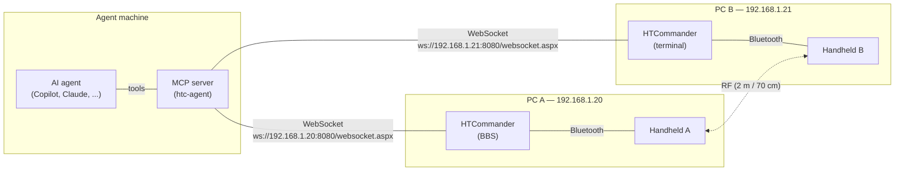

# Two Radios, One Agent: Letting an AI Drive Real Over-the-Air Tests

*Debugging a radio link means watching two stations at once: what one side
sent, what the other side heard, and when. Until now that has meant a human
relaying packet captures, log lines and observations between two PCs and an
assistant. This post looks at how an AI agent could connect to two
HTCommander instances on different machines, control them, and read their
packet captures and logs live. The agent could then run a real over-the-air
test, see both sides of the link, change a setting and run it again. It builds
on the WebSocket bridge HTCommander already has. It describes what works today,
what is missing, and a small, opt-in automation channel that would close the
gap.*

> **Status:** The WebSocket bridge in "What exists today" is shipping code.
> **All four steps are implemented:** observation (`hello`, `ping`,
> `subscribe`, `unsubscribe`, `packets`, `logs`, `get`) and control
> (`command`, `stop`) with the operator banner and Stop button, the
> transmit-time limit and fail-safe release, the headless terminal
> (`terminal.*`) (see [Reference (implemented)](#reference-implemented)),
> plus the Node test client and MCP server in `src/tools/htc_agent/`.

---

## Why bother?

The XARA work showed the gap clearly. Two HTCommanders on two Windows PCs, each
with a Bluetooth handheld, were set up as a terminal and a BBS. The BBS heard
the terminal's connect requests, but the terminal kept missing the BBS's
replies. Finding out why took several rounds of the same steps:

1. Try to connect on PC A.
2. Look at the packet capture on PC B, then on PC A.
3. Describe what was seen to the assistant.
4. Add more detail to the capture (bandwidth, level, SNR, control-code keys,
   reply windows) and repeat.

A simulation eventually found the cause: the station's latency did not include
the 300 ms key-up pre-roll, so ARQ control codes arrived after their reply
window and were dropped. But each field check still needed a person to read
two screens and type out what they saw. An agent that can read both captures
directly, and correlate them by time, could go through those steps much
faster. It could also run tests a person would not have time for, such as a
latency sweep with ten connection attempts at each setting.

---

## The shape of the setup



Each HTCommander keeps doing what it already does: it owns its radio, runs the
modems, the BBS, the terminal and the packet store. The agent never talks to a
radio directly. It talks to each HTCommander over the network, in the same
way the hosted web UI does, through a small client that combines both
stations into one set of tools.

---

## What exists today

The desktop app has a built-in web server (see
[The Same App, Two Homes](web-hosted-in-desktop.md)). It is enabled by the
`webServerEnabled` setting, listens on `webServerPort` (default **8080**) on
**all IPv4 interfaces**, and serves a WebSocket at `/websocket.aspx`. The
hosted web UI uses that WebSocket, and any other client can too. Today it
carries:

| Direction | Message | Meaning |
|---|---|---|
| host → client | binary, first byte `0x00` | Raw radio response frames (GATT) |
| host → client | binary, first byte `0xF1` | Host audio (`[0xF1, channels, rateLo, rateHi]` + 16-bit PCM), after `audioon` |
| host → client | `settings:{...}` / `setting:{"name","value"}` | Device-0 settings snapshot and live changes. Credentials (passwords, tokens, passcodes, API keys) are never sent; `HostConfiguredCredentials` lists only which ones are set |
| host → client | `history:` / `mail:` / `winlinkstate:` / `winlinkerror:` | Comms/APRS history, Winlink mail and status |
| host → client | radio state / `log:` text | Connected, connecting, disconnected; short messages |
| client → host | binary | Raw radio command frames, sent to the selected radio |
| client → host | `setsetting:{"name","value"}` | Change a synced device-0 setting (software-modem settings are applied live; credentials and agent settings are refused) |
| client → host | `selectradio:<id>`, `connect`, `disconnect` | Pick or drop the bridged radio |
| client → host | `audioon` / `audiooff`, `mailop:`, `winlinksync:`, `clear:` | Audio tap, mail and history operations |

That is already useful. For example, a client can switch a station to the XARA
software modem with
`setsetting:{"name":"SoftwareModemMode","value":"XARA"}`, or turn on wide
mode with `setsetting:{"name":"XaraWide","value":true}`.

It is **not enough** for testing, for five reasons:

- **No packet capture.** Captured frames (`PacketStored` on device 1) are never
  sent to WebSocket clients, so the XARA session details are not visible
  remotely. These include bandwidth, level, SNR, control-code keys and reply
  verdicts.
- **No logs.** `LogInfo` / `LogError` (device 1) stay inside the app.
- **No test commands.** You cannot start a BBS, lock a radio to a channel, or
  issue `XaraConnect` / `XaraSend` / `XaraDisconnect` over the socket. Some of
  these broker messages take typed objects (`SetLockData`, `CreateBbsData`) that
  a generic JSON message cannot represent.
- **The terminal is a widget.** The terminal's connect logic (lock the radio,
  start an AX.25 or XARA session, wait for the link) lives in the terminal tab's
  UI code, not in a handler, so nothing outside the UI can start it.
- **No authentication.** Anyone who can reach the port can drive the bridge.
  That is acceptable for a web page on a home LAN. It is not acceptable for an
  interface that can make a radio transmit.

---

## The proposal: an opt-in automation channel

The plan is to add a third message family to the same WebSocket, next to the
web UI's messages, so no new port or server is needed. Every automation
message is a text frame starting with `agent:` followed by a JSON object. The
host only handles them when the operator has turned the feature on.

### Turning it on

Two new settings, on each HTCommander:

- **`AgentApiEnabled`** — off by default. When off, the host ignores every
  `agent:` message.
- **`AgentApiToken`** — a random secret generated when the feature is turned
  on, shown in the settings with a copy button. Each connection must
  authenticate with it before any other `agent:` message is accepted. It is
  stored as a secret, like `RepeaterBookToken`, and never synced to the hosted
  web UI.

### Requests and replies

Requests carry an `id`; the host replies with the same `id`.

```text
agent:{"id":1,"op":"hello","token":"<AgentApiToken>"}
agent:{"id":1,"ok":true,"station":"N0CALL","app":"1.6.x","hostTime":"2026-11-01T07:42:10.512Z","radios":[{"id":101,"name":"UV-Pro","state":"Connected"}]}
```

Proposed operations:

| `op` | Purpose |
|---|---|
| `hello` | Authenticate; returns callsign, version, host clock and radios |
| `subscribe` / `unsubscribe` | Start or stop streaming broker events, by name (allowlist below) |
| `packets` | Recent packet capture, decoded (`since` time, `limit`) |
| `logs` | Recent log lines from a ring buffer (`since`, `level`) |
| `get` | Read one broker value (`device`, `name`), e.g. `LockState`, `XaraLinkState` |
| `command` | Run one allowlisted, typed command (below) |
| `stop` | Emergency stop: abort XARA, disconnect sessions, unlock every radio |

### Events the agent can subscribe to

These are pushed as `agent:{"event":...,"device":...,"time":...,"data":...}`.
The list is an allowlist, so the agent does not get every internal broker
message:

- **Packet capture:** `PacketStored`, sent with the same decoding the packet
  capture tab uses. That includes the raw fragment JSON
  (`TncDataFragment.toJson`), the summary line
  (`PacketDecoder.fragmentToShortString`), the modem label
  (`PacketDecoder.encodingLabel`, e.g. *"Software XARA FM Narrow Level 5
  (8PSK, 58 carriers, LDPC 2/3, 4252 bps), Session, SNR 18.4 dB"*), the decode
  sections, and the over-the-air bytes (`PacketDecoder.frameBytes`).
- **Logs:** `LogInfo`, `LogError`.
- **XARA:** `XaraEvent` (connected, disconnected, timedOut, bitrate, ...) and
  `XaraLinkState`.
- **BBS:** `BbsControlMessage`, `BbsTraffic`, `BbsError`.
- **Radio:** `LockState`, `State`, `HtStatus` (channel, RSSI, transmitting).

Sending the decoded view, not only raw bytes, matters. The agent then reads
exactly what a person reads in the capture tab, for example *"XARA control:
Connect reply (narrow) [U=0x4A1C2F] (9 hits) - dropped: late, 2612 ms > window
2512 ms"*, and does not need its own copy of the XARA decoders.

### Allowlisted commands

`command` runs only named operations. Each one has a typed JSON shape that
the host converts to the real broker message:

| `command` | Maps to | Notes |
|---|---|---|
| `bbs.start` `{radio, channel, region}` | `CreateBbs` (`CreateBbsData`) | Locks the radio to the BBS channel |
| `bbs.stop` `{radio}` | `RemoveBbs` | |
| `radio.lock` `{radio, usage, channel, region, modem, xaraWide}` | `SetLock` (`SetLockData`) | Same lock the terminal uses |
| `radio.unlock` `{radio, usage}` | `SetUnlock` | |
| `xara.connect` `{radio, remote, vias}` | `XaraConnect` | Needs the radio locked with modem `XARA` |
| `xara.send` `{radio, text \| hex}` | `XaraSend` | |
| `xara.disconnect` / `xara.abort` `{radio}` | `XaraDisconnect` / `XaraAbort` | |
| `terminal.connect` `{radio, contact}` | Terminal session (see below) | Uses a saved Terminal contact |
| `terminal.send` / `terminal.disconnect` | Terminal session | |
| `packets.clear` | `ClearPackets` | Start each run with an empty capture |
| `setting.set` `{name, value}` | Same path as `setsetting:` | Lets the agent change XARA timing between runs |

Everything else is left out on purpose: firmware updates, deleting contacts or
mail, the transmit-allow switch, and raw `SendRawCommand` writes. An agent that
can only run tests cannot damage a radio or a station's data.

The terminal's connection logic (radio lock, AX.25 or XARA session start,
timeouts, send and disconnect) lives in a headless `TerminalHandler`, in the
same way `BbsHandler` and `WinlinkClient` already work. The terminal tab is
one user of that handler and the automation channel is another, so an agent
tests exactly what an operator does in the Terminal tab, and the tab on that
PC shows the agent's session live.

---

## A lightweight test client

The client is `src/tools/htc_agent/htc_agent.mjs`: plain Node.js with no
dependencies, using the WebSocket client built into Node 22 and later. Its
`Station` class:

- connects lazily and authenticates with `hello`;
- estimates the host's clock offset from the round trip;
- subscribes to every event and keeps a buffer with a cursor, so a test can
  wait for something that may already have happened;
- exposes `call()` and `command()`, which throw on errors.

`timeline()` merges the packet captures of several stations by
clock-corrected time.

A complete over-the-air test is then a short script:

```js
import { Station, timeline } from './htc_agent.mjs';

const bbs = new Station('bbs', 'ws://192.168.1.20:8080/websocket.aspx', process.env.HTC_TOKEN_BBS);
const term = new Station('term', 'ws://192.168.1.21:8080/websocket.aspx', process.env.HTC_TOKEN_TERM);

for (const s of [bbs, term]) await s.command('packets.clear');
await bbs.command('setting.set', { name: 'SoftwareModemMode', value: 'XARA' });
await bbs.command('bbs.start', { radio: 101, channel: 'BBS' });
await term.command('radio.lock', { radio: 101, channel: 'BBS', modem: 'XARA' });

try {
  const from = term.cursor;
  await term.command('xara.connect', { radio: 101, remote: 'N0CALL-1' });
  const up = await term.waitFor({ after: from, names: ['XaraEvent'], contains: 'connected', timeoutMs: 120000 });
  if (up) {
    await term.command('xara.send', { radio: 101, text: 'S\r' });
    await term.waitFor({ names: ['PacketStored'], contains: 'open source', timeoutMs: 120000 });
  }
} finally {
  for (const s of [term, bbs]) await s.call('stop');
}

for (const r of await timeline([bbs, term])) {
  console.log(`${r.t.toFixed(3).padStart(8)} ${r.station.padEnd(4)} ${r.dir} ${r.summary}`);
}
```

The merged timeline makes cross-station problems easy to see. For example, a
connect reply the BBS sent at *t* shows up on the terminal at
*t* + 1.9 s, marked as *dropped: late*.

Two practical notes:

- **Clock correction.** Each PC stamps packets with its own clock. The `hello`
  round trip gives a rough offset per host, usually within a few
  milliseconds on a LAN. That is enough to line up frames that are hundreds of
  milliseconds apart. NTP on both PCs helps too.
- **The web UI can stay open.** `agent:` messages share the socket protocol
  with the hosted web page. A person can watch the same station in a browser
  while the agent runs the test.

---

## Connecting it to an AI agent with MCP

Agents such as GitHub Copilot and Claude call tools through the
[Model Context Protocol](https://modelcontextprotocol.io).
`src/tools/htc_agent/htc_agent_mcp.mjs` is a stdio MCP server built on the
client above. Each tool takes a station name, so one agent drives both PCs:

| Tool | Does |
|---|---|
| `list_stations` | Connects to every station: callsign, radios, transmit allowed, transmit limit, clock offset |
| `get_packets(station, since?, limit?, details?)` | Decoded packet capture |
| `get_timeline(stations?, since?, limit?)` | Captures merged and clock-corrected |
| `get_logs(station, since?, level?)` | Log lines |
| `get_value(station, device, name)` | Lock state, link state, radio status, settings (no secrets) |
| `get_events(station, after?, names?, contains?)` / `wait_for(...)` | Buffered events since a cursor / wait for the next match |
| `radio_lock` / `radio_unlock` | Lock a radio, optionally with the XARA modem |
| `bbs_start` / `bbs_stop` | Run the BBS |
| `xara_connect` / `xara_send` / `xara_disconnect` / `xara_abort` | XARA links from an agent-held radio |
| `terminal_connect` / `terminal_wait` / `terminal_send` / `terminal_disconnect` / `terminal_abort` | The station's Terminal, with an address-book terminal contact (any protocol, including XARA Narrow/Wide) |
| `clear_packets`, `set_setting` | Clear a capture; change modem settings such as `XaraTxLatencyMs` live |
| `stop_all` | Emergency stop on every station |

Every command returns an event `cursor`. Passing it to `wait_for` waits only
for what that command caused. Station URLs and tokens come from the
environment (`HTC_STATIONS` plus `HTC_TOKEN_<NAME>`) or a JSON file, never
from the tools. In VS Code the tokens can be prompted for and stored as
secrets:

```json
{
  "inputs": [
    { "type": "promptString", "id": "htcBbsToken", "description": "HTCommander BBS agent token", "password": true },
    { "type": "promptString", "id": "htcTermToken", "description": "HTCommander terminal agent token", "password": true }
  ],
  "servers": {
    "htc-agent": {
      "type": "stdio",
      "command": "node",
      "args": ["${workspaceFolder}/src/tools/htc_agent/htc_agent_mcp.mjs"],
      "env": {
        "HTC_STATIONS": "bbs=ws://192.168.1.20:8080/websocket.aspx,term=ws://192.168.1.21:8080/websocket.aspx",
        "HTC_TOKEN_BBS": "${input:htcBbsToken}",
        "HTC_TOKEN_TERM": "${input:htcTermToken}"
      }
    }
  }
}
```

`node src/tools/htc_agent/htc_agent_mcp.mjs --check` verifies the
configuration from a terminal. The tool's
[README](../../src/tools/htc_agent/README.md) covers setup for other MCP
clients.

With that in place, a request such as *"Connect the terminal to the BBS over
XARA Narrow five times at `XaraTxLatencyMs` 500, 800 and 1100, and tell me
which control codes were dropped and why"* becomes a loop the agent can run
by itself. For each setting it would:

1. Clear both captures.
2. Change the setting on both stations.
3. Start the BBS.
4. Lock the terminal radio for XARA and connect.
5. Wait for the link to come up, or time out.
6. Stop everything.
7. Read the merged timeline.

It would then group the dropped-code verdicts by setting and report the
result, for example: *"At 500 ms, 7 of 9 connect replies were late (median 2.6 s
against a 2.5 s window). At 800 ms, all replies were accepted, with 0.4 s of
margin."*

---
## Safety first: this makes radios transmit

An automation interface that can key a transmitter needs firmer limits than a
dashboard does:

- **Off by default, token required, LAN only.** The web server already binds
  to every interface. Do not forward its port to the internet. To reach a
  station from elsewhere, use a VPN or an SSH tunnel.
- **A control operator stays in charge.** Over-the-air testing is still
  amateur radio operation. The licensed operator must be able to stop
  transmissions immediately. In the app, that means a visible "Agent control
  active" indicator and a one-click stop that runs the same code as
  `agent:stop`. Every agent-started transmission must follow the station's
  identification rules and the band plan. Automatic control rules differ by
  country, so check yours.
- **Limited transmit time.** A host-side limit on agent-started transmit time
  per minute stops a looping test from using up a frequency.
- **Allowlist, not a broker passthrough.** The agent gets the commands a test
  needs and nothing else.
- **Fail safe.** If the socket drops or the host stops hearing from the
  client, the host aborts any link the agent started and unlocks the radio.

---

## A path to get there

The work splits into small, separately useful steps:

1. **Read-only observability — done.** `hello`, `subscribe`, `packets`,
   `logs` and `get`, behind `AgentApiEnabled` and `AgentApiToken`. This step
   cannot transmit, so it carries little risk, and it already lets an agent
   watch both captures live during a test run by a person.
2. **Allowlisted commands and `stop` — done.** Typed `command` handlers for
   BBS, radio lock, XARA, packet clearing and modem settings, plus the operator
   banner, the Stop button, the transmit-time limit and the fail-safe release.
3. **A headless terminal handler — done.** `TerminalHandler` owns the
   terminal's connect logic; the Terminal tab, detached terminal windows and
   `terminal.*` all drive it through broker commands.
4. **The client and the MCP server — done.** `src/tools/htc_agent/` holds a
   zero-dependency Node client and a stdio MCP server, with a two-station
   configuration and the merged timeline. An end-to-end test drives a real
   HTCommander web server through it.

Each step is tested without radios. `test/agent_api_test.dart` runs the
protocol over a real WebSocket. `test/htc_agent_mcp_test.dart` starts the
Node MCP server against an in-process HTCommander web server and drives it
over MCP, as an agent would. The XARA link itself is covered by the
simulation tests (see `test/xara_radio_latency_test.dart`).

The radios still have the final say: real Bluetooth delay, squelch timing and
RF conditions can only be measured over the air. This setup lets an agent run
those measurements itself, and correlate both stations' captures, without a
person relaying them by hand.

---

## Reference (implemented)

The implementation is `AgentApi` in `src/lib/handlers/agent_api.dart`, wired
into the web server's WebSocket by `WebServerHandler`. The tests in
`src/test/agent_api_test.dart` exercise it over a real socket.

**Turning it on.** In **Settings → Servers**, enable the web server, then tick
**Allow test agents (automation API)**. A random 192-bit token is generated
and shown with copy and regenerate buttons. The token is stored as an
encrypted secret (`AgentApiToken`). Neither `AgentApiEnabled` nor
`AgentApiToken` is ever sent to, or accepted from, the hosted web UI, so a
browser on the bridge can neither read the token nor turn the API on.
Switching the API off drops every agent session immediately.

**Messages.** Text frames `agent:{json}`. Replies echo the request `id` and
carry `ok`, plus `error` when `ok` is false.

| `op` | Arguments | Reply |
|---|---|---|
| `hello` | `token` | `protocol` (2), `app`, `station`, `hostTime` (UTC), `radios` (`id`, `name`, `state`), `events`, `commands`, `settable`, `allowTransmit`, `txSecondsPerMinute`, `readOnly` (false) |
| `ping` | — | `hostTime` |
| `subscribe` / `unsubscribe` | `events`: list of names, or `["*"]` | The session's current `events` |
| `packets` | `since` (ISO time, exclusive), `limit` (default 200, max 2000), `details` | `packets`: `time`, `incoming`, `radio`, `radioMac`, `channel`, `channelId`, `regionId`, `usage`, `frameType`, `encoding`, `summary`, `hex` (over-the-air bytes), and `decode` sections when `details` is true |
| `logs` | `since`, `level` (`"error"` for errors only), `limit` (default 500, max 5000) | `logs`: `time`, `level`, `message` |
| `get` | `device`, `name` | `value` |
| `command` | `command`, `args` | `command` plus command-specific fields |
| `stop` | — | `released`: what was released |

**Rules.**

- Every operation except `hello` requires a successful `hello` first. After
  five bad tokens, the host stops answering that connection.
- Subscribable events: `PacketStored`, `LogInfo`, `LogError`, `XaraEvent`,
  `XaraLinkState`, `BbsControlMessage`, `BbsTraffic`, `BbsError`,
  `LockState`, `State`, `HtStatus`, and the terminal's `TerminalState`,
  `TerminalText`, `TerminalNotice`. They are pushed as
  `agent:{"event","device","time","data"}`. Packets are always sent with
  their decode sections.
- `get` can read:
  - device-0 settings, except anything whose name looks like a secret
    (password, token, passcode, API key);
  - device 1 `ConnectedRadios`, `SelectedRadioDeviceId` and `TerminalState`;
  - per radio `State`, `LockState`, `HtStatus`, `XaraLinkState`,
    `FriendlyName`, `Channels`, `RegionNames` and `AudioState`.
- Observation never transmits or changes anything. Control is described below.

**Commands** (`agent:{"id":5,"op":"command","command":"radio.lock","args":{...}}`):

| `command` | `args` | Effect |
|---|---|---|
| `radio.lock` | `radio`; optional `usage` (`Agent` default, or `Terminal`), `channel` (id or name), `region` (index or name), `modem` (`Hardware`, `AFSK1200`, `PSK2400`, `DART`, `XARA`), `xaraWide` | Locks the radio, as the terminal does. Refused if the radio is already locked. |
| `radio.unlock` | `radio` | Aborts XARA and releases an agent lock |
| `bbs.start` | `radio`; optional `channel` (id or name in the current region; default the current channel A) | Starts the BBS (which locks the radio) |
| `bbs.stop` | `radio` | Stops a BBS an agent started |
| `xara.connect` | `radio`, `remote`, optional `vias` (at most 2) | `XaraConnect` |
| `xara.send` | `radio`, `text` or `hex` (up to 64 KB) | `XaraSend` |
| `xara.disconnect` / `xara.abort` | `radio` | `XaraDisconnect` / `XaraAbort` |
| `terminal.connect` | `radio`, and `contact` (callsign of a terminal contact in the address book) or `station` (ad-hoc `StationInfo` JSON) | Connects the host's Terminal with the contact's protocol and channel. Refused while the terminal is busy or the radio is locked; fails with the terminal's notice (e.g. `channelMissing`) when it cannot start |
| `terminal.wait` | `radio` | Terminal waits for an incoming AX.25 session |
| `terminal.send` | `text` | Types a line into the agent's terminal link (refused until `canSend`) |
| `terminal.disconnect` / `terminal.abort` | — | Graceful disconnect / immediate stop of the agent's terminal link |
| `packets.clear` | — | Clears the packet capture |
| `setting.set` | `name`, `value` | Only `SoftwareModemMode`, `SoftwareModemFec`, `DartTxMode`, `XaraWide`, `XaraTxLatencyMs`, `XaraTxKeyUpMs`; modem settings apply live (XARA modems rebuild, dropping any link) |

**Control rules.**

- `radio.lock`, `bbs.start`, `xara.connect`, `xara.send`, `terminal.connect`,
  `terminal.wait` and `terminal.send` can transmit. They
  need the station's **AllowTransmit** setting. The `xara.*` commands only act
  on a radio an agent holds (through `radio.lock` or `bbs.start`), so an agent
  can never drive a link the operator or another feature started. Locks and
  BBSes started outside the agent API can't be released by an agent.
- **Transmit limit.** Each radio an agent holds may transmit at most
  `AgentApiTxSecondsPerMinute` seconds (default 45) in any 60 s window,
  measured from the radio's own `isInTx` status. Going over releases the
  agent's hold on that radio, sends an `AgentLimit` event, and refuses
  transmitting commands on that radio for 60 s.
- **Fail-safe.** When an agent's socket closes, everything it held is
  released: XARA is aborted, BBSes and its terminal link are stopped and locks are released. A lock
  released by someone else is simply forgotten.
- **`stop`** releases everything every agent holds; agents stay connected.
- **Operator Stop.** While any agent is authenticated, HTCommander shows a
  red banner above the status bar ("A test agent is controlling this
  station", with the radios it holds) and a **Stop & disable** button. Stop
  sends each agent an `AgentStopped` event, releases everything, drops the
  sessions and turns `AgentApiEnabled` off, so agents can't reconnect until
  the operator re-enables access. Turning the setting off does the same.
- Every command is written to the log (`[AgentApi] Client N ran ...`).

A minimal session:

```text
→ agent:{"id":1,"op":"hello","token":"<token>"}
← agent:{"id":1,"ok":true,"protocol":1,"station":"N0CALL-1","hostTime":"2026-11-01T07:42:10.512Z","radios":[{"id":101,"name":"UV-Pro","state":"Connected"}],"events":[...],"readOnly":true}
→ agent:{"id":2,"op":"subscribe","events":["PacketStored","XaraEvent"]}
← agent:{"id":2,"ok":true,"events":["PacketStored","XaraEvent"]}
← agent:{"event":"PacketStored","device":101,"time":"...","data":{"summary":"XARA control: Connect reply (narrow) [U=0x4A1C2F] (9 hits) - dropped: late, 2612 ms > window 2512 ms","encoding":"Software XARA FM, Session control (...)",...}}
```

---

**Related:** [The Same App, Two Homes: Running HTCommander's Web UI Inside the
Desktop](web-hosted-in-desktop.md) ·
[How XARA-FM Works](xara-fm-how-it-works.md) ·
[Bringing XARA Into HTCommander](xara-modem-integration-plan.md)
