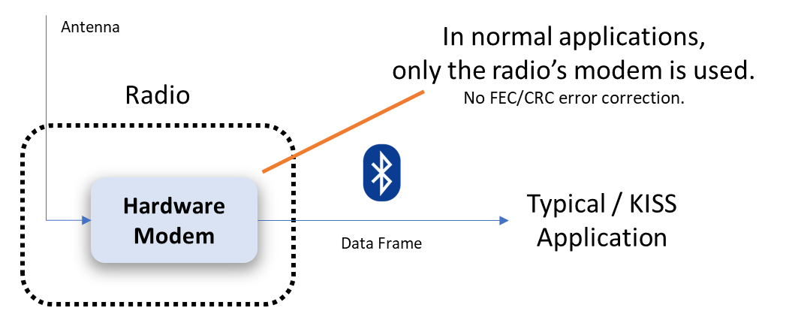
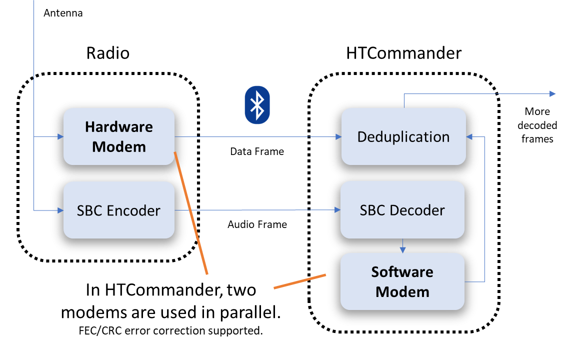
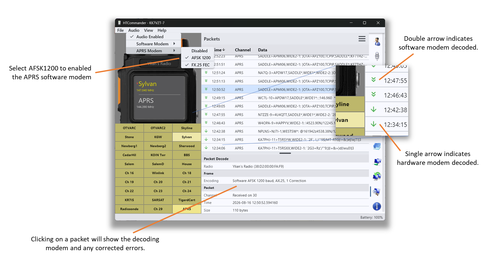

# Two Modems Are Better Than One: Running a Software APRS Modem Alongside the Radio's

*How HTCommander decodes APRS twice — once with the radio's built-in hardware TNC
and once with a software modem that adds FEC and CRC error recovery — and quietly
pulls in the packets the radio alone would have thrown away.*

---

## The problem: the radio's TNC drops packets

Most APRS apps talk to a handheld the same way: over KISS. The radio's built-in
hardware modem (its TNC) listens to the air, decodes every AX.25 packet it can,
and hands the finished data frames to the app over Bluetooth. The app never
touches the raw audio — it only ever sees the packets the radio already decoded.



That works, but the radio's TNC is a modest modem — and for good reason: it runs
on a handheld's limited compute. It has two real limitations:

- **No forward error correction.** It doesn't understand FX.25, so a packet sent
  with FEC is decoded as if the FEC bytes were just noise — and if the payload
  took a hit, it's gone.
- **No CRC error recovery.** AX.25 frames carry a CRC. The radio's TNC treats it
  as pass/fail: if a single bit is wrong, the CRC fails and the whole packet is
  discarded. It never tries to work out *which* bit flipped and put it back.

On top of that, a small hardware modem simply *misses* packets — weak signals,
timing edges, a bit of fading — and every miss is a position report or message
you never see. Over an afternoon of listening, the lost-packet count adds up
fast.

**This isn't a bug in the radio.** It's easy to look at the dropped packets and
conclude the radio's modem is broken, but that's not what's going on. A handheld
simply doesn't have the processing power or memory to throw at the AX.25/APRS
problem that a mobile or desktop device does, and there's no reason to expect
that to change. The heavy lifting that recovers marginal packets — FX.25 forward
error correction, or brute-forcing a failed CRC by flipping bits until the frame
checks out — is a big compute ask on both the send and receive side, and that's a
lot to demand of a small radio. In reality the radio decodes AFSK 1200 packets
just fine within its capacity; expecting a Direwolf-class modem to run inside a
handheld would not be a fair ask. The point of the software modem isn't to fix
the radio — it's to let a device that *does* have the compute pick up the packets
the radio couldn't.

## The idea: decode the same signal twice

The radio is already sending HTCommander something the KISS world ignores: the
**audio**. When you enable the audio channel, the radio streams the received
audio to the app over Bluetooth (compressed with SBC). HTCommander was built to
run its own **software modem** on that audio stream — the same DSP pipeline it
uses for DART and PSK — and it can run a full **AFSK 1200** APRS demodulator
there too.

So the same over-the-air signal gets decoded twice, in parallel:



- The **hardware modem** in the radio decodes the packet and sends the finished
  data frame over Bluetooth, exactly as before.
- The **software modem** in HTCommander decodes the SBC audio stream itself — and
  because it's a real software modem, it can do the two things the radio can't:
  **FX.25 forward error correction** and **CRC-based single/multi-bit recovery**.

The hardware modem is almost always faster — it's decoding in real time on
dedicated silicon — so when it succeeds, its packet arrives first and wins. But
when the radio's TNC comes up empty (no FEC, a failed CRC, or a missed packet
entirely), the software modem gets its shot at the same audio and often pulls the
packet out anyway.

## Making the two agree: deduplication

Running two decoders on one signal means the *same* packet can be decoded twice —
once by each modem. HTCommander wraps both sources behind a small
**deduplicator** so you never see doubles. It keys each finished frame by its raw
bytes and suppresses any identical frame seen again inside a short window (a few
seconds); the first copy through wins and the rest are dropped. Because the
hardware modem is faster, it usually gets there first — and only the packets it
*couldn't* decode fall through to be filled in by the software modem.

The net effect: you get the union of what both modems can hear, with none of the
duplicates.

## Native AFSK/PSK DSP

On Windows, Linux, macOS and Android, the live AFSK/PSK software modem uses a
[native C++ DSP kernel](../../src/native/packet_modem.cpp). Receive filtering,
AGC, phase detection, symbol timing and carrier detection run in blocks of up
to 256 samples. Bounded leaf FFI calls borrow pinned PCM and event typed lists
directly, eliminating the receive copy and the previous 2 KB PCM staging buffer
per modem. The smaller blocks also reduce event-buffer capacity. Input is never
modified or retained by the native kernel, and calls stay short so the runtime
can resume garbage collection between blocks.

Each modem owns tap-sized circular histories and a reusable event buffer; there
are no per-sample heap allocations or Dart/native callbacks. Only recovered bits,
quality measurements and carrier changes return to the existing Dart HDLC/FX.25
receivers. Both the prefilter and mixer low-pass filters compute four consecutive
outputs together using SIMD, retaining the original accumulation order for each
output. Mixing can be batched because its oscillators and input delays do not
depend on symbol/AGC feedback. PSK bit-quality interpolation and rounding run only
at symbol strobes; the per-sample Gray decision preserves the reference's
halfway-to-one rule.

Mode dispatch happens once per block. Mode-specific loops fix the mixer channel
count and PSK symbol width instead of branching on them for each sample.
Prefilter histories put consecutive outputs directly into chronological SIMD
lanes, avoiding per-tap lane reversal. Carrier detection uses fixed-cost integer
population counts without requiring optional CPU instructions.

Only active slicer states are allocated, with their gains stored alongside them
instead of in a separate allocation. Self-correlating PSK profiles also omit the
unused 256-entry oscillator table, saving another 1 KiB per modem. Local-oscillator
profiles, including the app's PSK 2400 default, still retain that table.

Transmit framing, bit stuffing, NRZI and FX.25 FEC are unchanged. The encoder
isolate collects one byte per NRZI level, then generates PCM in one native call,
avoiding the old boxed integer list for every audio sample. Preamble, postamble,
symbol grouping and PTT silence retain their existing timing. The kernels cover
both AFSK profiles, QPSK (V.26 A/B) and 8PSK; the app's PSK mode remains PSK 2400.
The returned PCM owns its native allocation through a Dart typed-list finalizer,
so no second full-size PCM buffer or copy is needed. This saves about 320 KB of
temporary PCM storage for five seconds of 32 kHz mono audio. Receive pipelines
also avoid allocating an unused transmit chain, and the native bit collector
does not construct or initialize a Dart tone generator.

Web and iOS retain the Dart implementation. For reference comparisons on a
native platform, build with `--dart-define=HT_PACKET_MODEM_DART=true`. Native
allocation/configuration errors are surfaced rather than silently switching
decoders mid-stream.

The [parity tests](../../src/test/native_packet_modem_test.dart) compare exact
PCM and recovered bit/quality/carrier events against Dart, including clipping,
noise, multiple slicers, short/wrapping FIRs and chunk boundaries. They also check
heap-backed, native-backed and read-only input views without modifying PCM. The
carrier tests exercise repeated acquisition and loss in both AFSK and QPSK. The
[transmit tests](../../src/test/modem_tx_encoder_test.dart) also compare complete
bundles with and without FX.25, including isolate reuse.

A Windows x64 AOT measurement of five seconds of audio (median of five runs
after three warmups) showed AFSK receive about **3x** and PSK 2400 receive
**3.5-4x** faster than Dart; tone generation was about **18-21x** faster. The
mixer batching and pinned-input pass cut receive time by a further **15%** for
AFSK and **35%** for PSK compared with the preceding native version. The subsequent
mode-specialization pass reduced PSK receive time by another **10%**, with AFSK
broadly unchanged. Specialization grew the Windows native DLL by about 7.5 KiB;
that code is shared by all modem instances. Transmit timings were unchanged in
these passes. These are DSP-only measurements, not
whole-application CPU figures, and vary by machine. Run the
[benchmark](../../src/test/packet_modem_benchmark.dart) from `src`:

```text
dart run test\packet_modem_benchmark.dart
dart build cli --target=test\packet_modem_benchmark.dart --output=build\packet-benchmark
build\packet-benchmark\bundle\bin\packet_modem_benchmark.exe
```

The last command is the Windows AOT benchmark. Use `dart build cli`, not
`dart compile exe`, so the native asset libraries are bundled.

## Turning it on

Two settings enable the feature. Both live under the **Audio** menu:

1. **Audio Enabled** — the software modem needs the audio stream. Enabling audio
   is enough; the channel does *not* have to be un-muted. Even when the channel
   is marked muted, HTCommander still receives the audio data (it just doesn't
   play it out your speakers), which is exactly what the modem needs.
2. **APRS Modem → AFSK 1200** — this switches on the software APRS demodulator.
   Leave **FX.25 FEC** enabled too, so the software modem can use forward error
   correction on packets that carry it.



That's it. From now on both modems are running, and the deduplicator quietly
merges their output.

## Seeing it work: the Packets tab

The proof is in the **Packets** tab, and it's designed so you can tell the two
modems apart at a glance:

- A **single arrow** next to a packet means the **hardware modem** decoded it —
  the radio's TNC got there first.
- A **double arrow** means the **software modem** decoded it — a packet you would
  *not* have seen with a KISS app.

Click any packet to open its decode details. The **Encoding** line tells you
which modem handled it and how much repair it took — for example
`Software AFSK 1200 baud, AX.25, 1 Correction` means the software modem decoded
it and had to flip one bit to make the CRC check out. If FX.25 forward error
correction was in play, you'll see that too, along with how many symbols it
recovered.

Leave the feature running for a while, then scan the Packets tab and count the
double arrows. Every one of them is a packet the radio's own modem missed or
rejected — a position, a message, or a beacon you'd have lost with a normal
setup. In practice it's a surprising number, and it costs you nothing but a
setting: a real boost in how much your radio actually hears.
