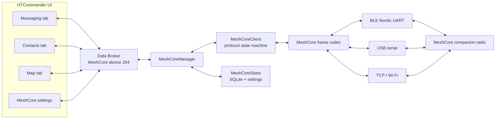
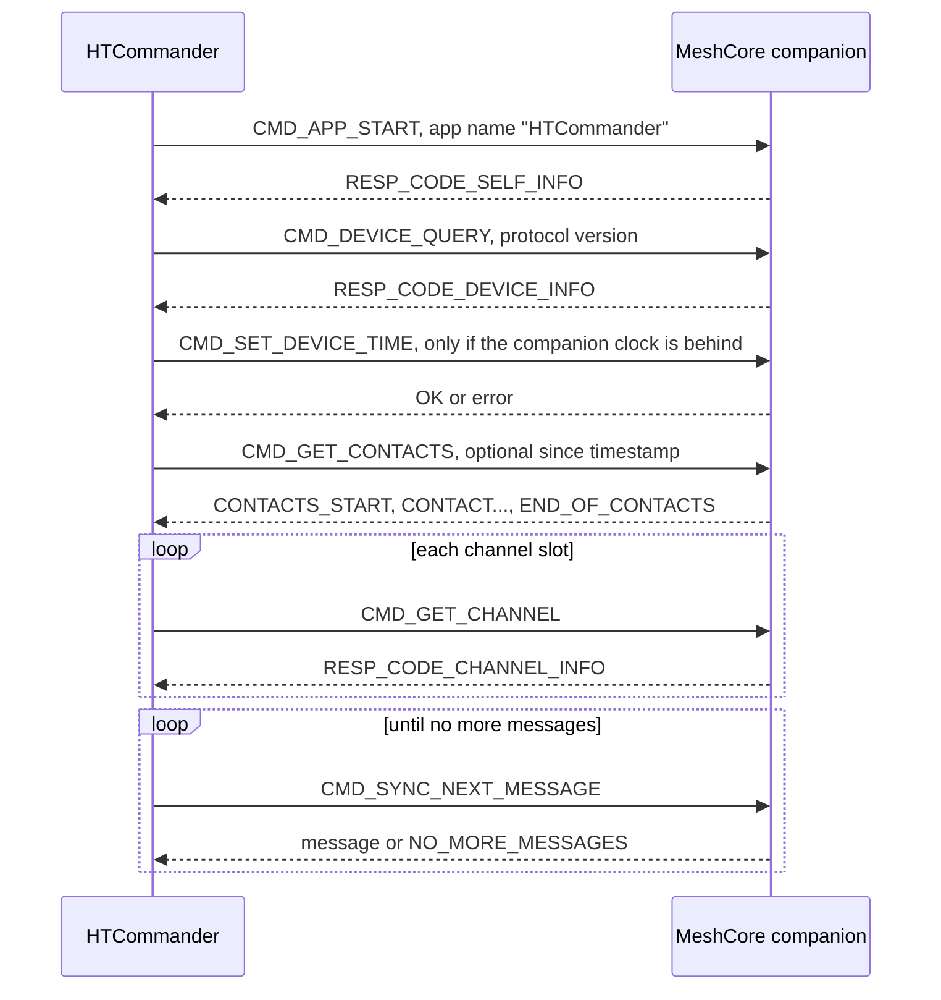

# Two Networks, One Inbox: Planning MeshCore Support in HTCommander

*A design note describing how HTCommander can become a MeshCore companion
client: how it will connect to a MeshCore radio, sync contacts and groups, show
MeshCore messages beside APRS in a new **Messaging** tab, and put MeshCore
stations on the map. The goal is a complete and practical implementation plan,
not a commitment to every MeshCore feature on day one.*

---

## Implementation status

The first slice is implemented and has been tried successfully with a Heltec V3
running companion firmware v1.16. MeshCore is opt-in: it is enabled with the
**MeshCore** checkbox under **Settings > Application > Features**. While the box
is unchecked, HTCommander does not connect to the companion and hides every
MeshCore entry point. The slice includes:

- **Bluetooth LE connection** to a MeshCore companion
  (`src/lib/meshcore/meshcore_ble_transport.dart`). Windows uses the existing
  `flutter_blue_plus_winrt` plugin for GATT. The companion only exposes its
  characteristics over an authenticated bond. HTCommander therefore pairs with
  the PIN shown on the device through new `blePair` / `bleUnpair` methods in
  the native Windows Bluetooth plugin.
- **Protocol codec and client** (`meshcore_protocol.dart`,
  `meshcore_client.dart`): handshake, clock sync, contact and channel sync,
  offline-queue draining, push frames, and direct-message delivery
  confirmations.
- **Manager on Data Broker device 204** (`meshcore_manager.dart`): reconnects
  automatically, retries direct messages up to three times (the last attempt is
  flooded), adds users and groups, and persists history in a new SQLite table
  (`meshcore_messages`, schema v2).
- **Messaging tab**: the visible tab name is now **Messaging** (internal ID still
  `APRS`). The tab has **All APRS Messages** and **All MeshCore Messages**
  feeds, MeshCore user and group conversations, a byte-limited composer,
  delivery icons, and dialogs to connect, add users and add groups.
- **Contacts**: a **MeshCore User** contact type stores the public key in the
  ID field and supports the same logo or custom-image avatar as other contacts.
  When adding one, a **Users known to the MeshCore radio** list fills in the
  key and name from the companion's contact table. Only address-book users get
  a conversation thread in the Messaging tab (the radio can remember many
  nodes); direct messages from anyone else still appear in **All MeshCore
  Messages**, where they can be added as contacts. The manager adds any
  address-book user missing from the companion's contact table so direct
  messages can be sent. Removing a contact from the address book does not
  remove it from the radio.

Not yet implemented: USB support on Android (OTG).

### USB and Wi-Fi

The connection dialog offers **Bluetooth**, **USB** and **Wi-Fi**, depending
on the platform: USB serial on Windows, macOS and Linux; Wi-Fi (TCP) everywhere
except the browser build. Both wired links use the same framing: a direction
byte (`<` to the radio, `>` from it) and a 16-bit little-endian length. USB
runs at 115200 baud; the Wi-Fi firmware listens on TCP port 5000 by default.

MeshCore ships separate companion firmware for each interface, so a board
flashed with the Bluetooth companion firmware does not answer over USB or
Wi-Fi. Opening a USB port can reset an ESP32 board; HTCommander retries the
initial device query to give it time to boot, and detects unplugging by
watching for the port to disappear.

### Bluetooth on each platform

The companion only exposes its data over an authenticated bond, so every
platform needs the PIN shown on the device (123456 on boards without a screen):

| Platform | How pairing works |
|---|---|
| Windows | HTCommander pairs through the native Bluetooth plugin with the PIN entered in the dialog. |
| Android | HTCommander requests the Bluetooth runtime permissions, then bonds with `createBond`, passing the PIN; Android shows its own dialog if needed. |
| Linux | HTCommander registers a temporary BlueZ agent that answers with the PIN, then pairs. Without a PIN, the desktop's Bluetooth agent prompts. |
| macOS, iOS | The system asks for the PIN the first time an encrypted characteristic is used. Re-pairing after a re-flash is done in the system Bluetooth settings. |
| Web (Chrome/Edge) | The browser's device chooser opens from the **Scan** button, and the browser asks for the PIN. Automatic reconnection at startup is not available. |

**Forget Pairing** is offered on Windows, Android and Linux.

Incoming **direct** MeshCore messages raise the same system notification as
APRS messages addressed to our station: only while HTCommander is not in the
foreground, and only when **Message Notifications** is enabled. Group and
channel messages never notify. Clicking an APRS or MeshCore notification
brings HTCommander to the front, switches to **Messaging** and opens that
conversation.

The **Map** tab has a **Show MeshCore Stations** option (hidden while the
feature is disabled). Nodes with an advertised position are drawn with a
type-specific icon (companion, repeater, room server, sensor), and the
companion itself in a darker colour. Selecting one shows its name, type,
shortened key, distance and last update, with actions to message it or add it
to Contacts. With **Show Contacts Only**, only MeshCore users in the address
book are drawn, matched by public key.

Right-clicking a MeshCore message in the Messaging tab offers **Details...**
(also opened by double-clicking a message in a thread) and, when the sender is
not yet in the address book, **Add Contact...**.

Many operators start a node name with their callsign, for example `KK7VZT`,
`KK7VZT-Base` or `KK7VZT Mobile`. When a MeshCore name starts with something
shaped like an amateur callsign, HTCommander looks it up in the offline
callsign database, as it does for APRS stations. On the map, the info card
shows the licence class, name and location, and the context menu adds
**Lookup...**. In the Messaging tab, a message's **Details** include the
callsign and licence fields, and its context menu adds **Lookup...**. The name
the node advertises is checked first, then the address-book name.

### Firmware findings that differ from the protocol guide

Where the published guide and the v1.16 companion firmware disagree, the code
follows the firmware:

- Text messages are limited to **160 bytes** (`MAX_TEXT_LEN`), not 133
  characters. BLE frames are at most 176 bytes (`MAX_FRAME_SIZE`, also the MTU
  the companion requests), which fits a 160-byte direct message exactly.
- `PUSH_CODE_SEND_CONFIRMED` carries a **4-byte** ACK tag (matching the tag in
  `RESP_CODE_SENT`) followed by a 4-byte round-trip time, not a 6-byte code.
- `CMD_SEND_CHANNEL_TXT_MSG` is answered with `RESP_CODE_OK`, not
  `RESP_CODE_SENT`.
- `RESP_CODE_CHANNEL_INFO` copies the name with `strcpy`, so bytes after the
  name terminator may be stale and must be ignored.
- The firmware only sends frames after BLE authentication completes, so an
  unpaired client sees nothing at all.

---

## Why MeshCore belongs in HTCommander

[MeshCore](https://github.com/meshcore-dev/MeshCore) is a lightweight LoRa mesh
network. A small **companion radio** connects to a phone or computer, and
**repeaters** forward packets across multiple hops. Each node has a public-key
identity rather than an amateur callsign. Users can exchange private direct
messages and group-channel messages, and nodes can advertise their location.

HTCommander already has most of the surrounding pieces:

- a conversation-style APRS screen;
- an address book;
- a map with station markers, filters and info panels;
- notifications, persistence and multi-window state through the Data Broker;
- device-specific transports for Bluetooth, serial ports and TCP.

MeshCore therefore fits best as **another messaging network inside the same
operator console**. APRS, SMS-through-APRS, Winlink and voice remain separate
services, but users can see and respond to both APRS and MeshCore conversations
from one place.

This is not a plan to make the supported Benshi handhelds speak LoRa. MeshCore
support requires a separate MeshCore companion device.

---

## Goals

The first complete version should let a user:

1. connect HTCommander to a MeshCore companion radio over BLE, USB serial, or
   TCP/Wi-Fi where the platform supports it;
2. rename the visible **APRS** tab to **Messaging**;
3. choose **All APRS Messages** or **All MeshCore Messages** in that tab;
4. add MeshCore users to Contacts using a name and 32-byte public key;
5. add MeshCore group conversations;
6. send and receive MeshCore direct and group messages;
7. see delivery status for direct messages;
8. persist MeshCore message history;
9. show MeshCore stations with advertised locations on the map; and
10. keep all existing APRS, SMS, settings and tab behavior intact.

## Non-goals for the first version

- **No APRS ↔ MeshCore gateway.** Bridging introduces identity, encryption,
  routing-loop, airtime, privacy and amateur-radio-rule questions. It deserves a
  separate design.
- **No MeshCore firmware flashing.** Users can continue to use the official
  MeshCore flasher.
- **No repeater or room-server administration.** Remote CLI, login,
  telemetry and repeater management can come later.
- **No binary file transfer.** MeshCore payloads are small. Files, SSTV,
  torrent blocks and Winlink attachments should remain on the existing
  services.
- **No automatic splitting by default.** Long messages should be blocked or
  explicitly split by the user. Silently creating multiple LoRa transmissions
  can waste shared airtime.

---

## The user experience

### APRS tab becomes Messaging

The visible tab label changes from **APRS** to **Messaging**. The internal tab
identifier stays `APRS`, and the detached-window type stays `aprs`.

That distinction matters. The tab label is currently used as a stable
identifier by tab ordering, hidden-tab settings and detached windows. Changing
the identifier would silently reset user preferences. The display name should
come from a new localized string such as `tabMessaging`, while `_TabInfo('APRS',
...)` remains unchanged.

The existing APRS-specific settings page should remain **APRS**. A new
**MeshCore** settings page should hold MeshCore connection settings.

### Conversation list

The current Messenger layout already has the right shape: a conversation list
on the left in wide layouts and a single-view switch in narrow layouts. The
Messaging tab keeps that design.

The top of the list will contain feed entries:

| Entry | Contents | Shown when |
|---|---|---|
| **All APRS Messages** | The current combined APRS feed. This replaces the existing **All Messages** label. | Always. |
| **All MeshCore Messages** | Every direct and group MeshCore message from the active companion radio. | MeshCore is enabled, configured, or has stored history. |

Below those feeds, the list shows conversations sorted by most recent activity:

- APRS stations;
- SMS contacts using the APRS SMS gateway;
- MeshCore users; and
- MeshCore groups.

Address-book entries without message history appear after active
conversations, as they do today.

Every non-APRS conversation needs a visible network badge so similarly named
peers are never ambiguous. For example:

```text
All APRS Messages
All MeshCore Messages
──────────────────────────────
Alice              MeshCore User    Are you on site?     2m
Field Team         MeshCore Group   Bob: Moving north    5m
K1ABC-7            APRS             Message received     1h
+1 555 123 4567    SMS              Thanks              3h
```

The **Add Contact** button becomes **Add Conversation** and offers:

- APRS Station;
- SMS / Phone;
- MeshCore User; and
- MeshCore Group.

### All MeshCore Messages

This feed is a monitoring view. It shows:

- incoming and outgoing direct messages;
- incoming and outgoing group messages;
- the conversation or group name;
- sender name or public-key prefix;
- hop count or route type when available;
- SNR when the companion supplies it; and
- delivery state for direct messages.

The first version should make this feed read-only. Users can open a message's
conversation from the feed and reply there. That avoids an easy mistake: a
reply typed into a mixed feed being sent to the public group instead of a
private recipient.

Context menu actions should include:

- **Open Conversation**;
- **Add Sender to Contacts** for resolved direct-message senders;
- **Copy Text**;
- **Copy Public Key** when known; and
- **Message Details**.

### MeshCore user conversations

Opening a MeshCore user shows a direct-message conversation. The composer:

- has no APRS route, destination or channel controls;
- shows a UTF-8 byte counter;
- disables **Send** while the companion radio is disconnected;
- warns when the contact has not been synchronized to the companion radio; and
- shows per-message delivery states.

Direct-message states should be:

| State | Meaning |
|---|---|
| Pending | Stored locally and waiting for the companion to accept it. |
| Sent | Accepted by the companion. |
| Delivered | The companion reported the matching acknowledgment. |
| Failed | The companion rejected it or the acknowledgment timeout expired. |

The current companion firmware rejects direct-message text longer than 160
bytes. HTCommander applies the limit before sending rather than relying on the
firmware error.

### MeshCore group conversations

Opening a MeshCore group shows that group's channel messages. Group messages
have no end-to-end delivery acknowledgment, so the UI must show only
**Pending**, **Sent** or **Failed**.

The current firmware sends group text as `<sender name>: <message>` and limits
the combined text to 160 bytes. If the result is too long, firmware truncates
the message. HTCommander must therefore count the companion's advertised name,
the colon and the space against the composer limit.

Incoming group messages do not carry a sender public key in the companion
frame. HTCommander can parse the conventional `Name: text` prefix for display,
but it must treat that name as **unverified**. It must not link the message to
a contact or show it as an authenticated identity merely because the names
match.

### Adding a MeshCore user

The MeshCore user dialog needs:

| Field | Required | Notes |
|---|---:|---|
| Name | Yes | Local display name. |
| Public key | Yes | 32 bytes, entered as 64 hexadecimal digits. |
| Description | No | Existing contact description field. |
| Avatar | No | Existing avatar support. |

Input normalization should accept uppercase or lowercase hex and ignore
spaces, colons and dashes. Validation rejects:

- the wrong length;
- non-hex input;
- an all-zero key;
- the connected companion radio's own key; and
- a duplicate MeshCore user key.

The Contacts tab should display a short fingerprint such as
`7f3a91c2…b04e2d18`, with a **Copy Public Key** action. It should never use the
fingerprint as the stored identity.

### Adding a MeshCore group

The group dialog supports three types:

| Type | User input | Secret source | Privacy |
|---|---|---|---|
| Public | Optional local name | MeshCore's well-known public channel key. | Public. |
| Hashtag | Hashtag name, such as `#field-day` | First 16 bytes of `SHA-256("#field-day")`. | Encrypted on air, but anyone who knows or guesses the name can derive the key. |
| Private | Name and an imported or generated 16-byte secret | User-supplied or cryptographically random. | Private to holders of the secret. |

Private groups need explicit **Copy Secret** and **Import Secret** actions.
HTCommander should not put private group secrets in normal logs, crash reports,
APRS cloud sync, contact exports or plaintext settings.

### Map

The Map menu gets **Show MeshCore Stations**, persisted as
`MapShowMeshCoreStations` and defaulting to enabled once MeshCore is used.

MeshCore markers should be visually distinct from APRS markers:

| MeshCore node type | Marker |
|---|---|
| Chat / companion | Person or chat icon. |
| Repeater | Tower icon. |
| Room server | Room or forum icon. |
| Sensor | Sensor icon. |
| Unknown | Generic MeshCore icon. |

Selecting a marker shows:

- display name;
- node type;
- public-key fingerprint;
- last heard time;
- advertised position;
- hop count or route type when known;
- whether the node is in the HTCommander address book; and
- actions for **Open Conversation**, **Add Contact** and **Copy Public Key**.

The existing **Show Contacts Only** filter should apply to MeshCore users. A
MeshCore node is a contact only if its full public key matches a saved MeshCore
user.

The marker age filter should use the time HTCommander or the companion radio
heard the advert, not only the remote node's advertised timestamp. Remote
clocks may be wrong.

---

## Architecture

MeshCore should follow the pattern already used by EchoLink, APRS-IS and
AllStarLink: a self-contained service exposed through the Data Broker.

The proposed MeshCore Data Broker device ID is **204**. Existing pseudo-devices
use 200 through 203, and 204 is not currently used as a Data Broker device ID.



### Proposed modules

```text
src/lib/meshcore/
  meshcore_constants.dart       command, response, push and error codes
  meshcore_codec.dart           byte readers/writers and frame parsers
  meshcore_models.dart          companion, contact, group, message models
  meshcore_client.dart          handshake, command queue and sync state machine
  meshcore_manager.dart         lifecycle, persistence and Data Broker wiring
  meshcore_transport.dart       transport interface and reconnect policy
  meshcore_ble_transport.dart   Nordic UART over flutter_blue_plus
  meshcore_serial_transport.dart
  meshcore_tcp_transport.dart
  meshcore_web_stub.dart        unsupported transports on web

src/lib/dialogs/
  meshcore_connection_dialog.dart
  meshcore_group_dialog.dart
  meshcore_message_details_dialog.dart

src/lib/services/db/
  meshcore_dao.dart
```

`MeshCoreClient` should be pure Dart with injected transport, clock and timer
dependencies. That keeps the protocol logic testable without hardware, matching
the EchoLink and APRS-IS designs.

The current `AprsTab` is large. The first implementation should not attempt a
broad rewrite. Instead:

1. introduce typed conversation keys;
2. extract the shared conversation-list model;
3. keep APRS sending and parsing in the existing APRS code;
4. add MeshCore-specific composer and message conversion; and
5. rename `AprsTab` to `MessagingTab` only after MeshCore behavior is covered by
   tests, or leave the class name unchanged until a separate refactor.

### Typed conversation keys

The current Messenger code identifies conversations with uppercase strings.
That works for APRS callsigns and phone numbers, but not for public keys or
group IDs. MeshCore needs a typed key:

```dart
enum MessagingNetwork { aprs, sms, meshCoreUser, meshCoreGroup }

class ConversationKey {
  final MessagingNetwork network;
  final String id;

  // APRS: normalized callsign
  // SMS: digits-only phone number
  // MeshCore user: lowercase 64-digit public key
  // MeshCore group: local group UUID
}
```

This prevents collisions such as a MeshCore node named `K1ABC` being mistaken
for APRS station `K1ABC`.

The selected-conversation state, avatar lookup, contact-name lookup and
`OpenConversation` requests should all move to this key. Existing APRS
conversation requests can be adapted to `ConversationKey.aprs(callsign)`.

---

## Companion protocol plan

The implementation should target the
[MeshCore companion protocol guide](https://github.com/meshcore-dev/MeshCore/blob/main/docs/companion_protocol.md),
using the companion firmware source as the authority when the guide is
incomplete.

### Transports

| Transport | Framing | Platform target |
|---|---|---|
| BLE | One protocol frame per Nordic UART notification or write. Service `6E400001-B5A3-F393-E0A9-E50E24DCCA9E`; app writes RX `6E400002-...`; firmware notifies on TX `6E400003-...`. | Android, iOS, macOS, Linux and supported web browsers; verify Windows support before advertising it. |
| USB serial | App to radio: `<`, little-endian 16-bit length, payload. Radio to app: `>`, little-endian 16-bit length, payload. Companion firmware uses 115200 baud. | Windows, Linux and macOS. |
| TCP | Same `<` / `>` length framing as USB. Current companion firmware defaults to port 5000. | Desktop and mobile platforms with `dart:io`; not browser builds. |

The transport layer should deliver complete payloads to the codec. Only the
serial and TCP transports need stream reassembly.

The existing Benshi BLE transport already knows about the Nordic UART UUIDs, so
MeshCore scanning must filter by both service UUID and successful protocol
handshake. A Nordic UART service alone does not prove a device is a MeshCore
companion.

### Connection and initial sync



The client must use a single in-flight command queue. Responses are matched by
the expected response type, with a timeout and recovery path. Push frames such
as `PUSH_CODE_MSG_WAITING`, `PUSH_CODE_ADVERT`, `PUSH_CODE_NEW_ADVERT` and
`PUSH_CODE_SEND_CONFIRMED` must be accepted at any time, even while another
command is waiting.

When `PUSH_CODE_MSG_WAITING` arrives, the manager drains the queue with
`CMD_SYNC_NEXT_MESSAGE` until it receives `NO_MORE_MESSAGES`.

Reconnect should use exponential backoff with a cap. A manual **Disconnect**
must stop reconnection.

### Commands needed for version 1

| Feature | Command or push |
|---|---|
| Start session | `CMD_APP_START`, `RESP_CODE_SELF_INFO` |
| Capability query | `CMD_DEVICE_QUERY`, `RESP_CODE_DEVICE_INFO` |
| Clock sync | `CMD_GET_DEVICE_TIME`, `CMD_SET_DEVICE_TIME` |
| Contact sync | `CMD_GET_CONTACTS`, `RESP_CODE_CONTACT`, `CMD_GET_CONTACT_BY_KEY` |
| Add or update contact | `CMD_ADD_UPDATE_CONTACT` |
| Remove contact | `CMD_REMOVE_CONTACT` |
| Group sync | `CMD_GET_CHANNEL`, `CMD_SET_CHANNEL` |
| Send direct message | `CMD_SEND_TXT_MSG`, `RESP_CODE_SENT` |
| Direct-message delivery | `PUSH_CODE_SEND_CONFIRMED` |
| Send group message | `CMD_SEND_CHANNEL_TXT_MSG` |
| Receive messages | `CMD_SYNC_NEXT_MESSAGE` and contact/channel message responses |
| Advertisements | `PUSH_CODE_ADVERT`, `PUSH_CODE_NEW_ADVERT` |
| Contact table changes | `PUSH_CODE_CONTACT_DELETED`, `PUSH_CODE_CONTACTS_FULL` |
| Status | `CMD_GET_BATT_AND_STORAGE` |
| Send own advert | `CMD_SEND_SELF_ADVERT` |

Version 1 should ignore unsupported and future push codes after logging them in
debug mode.

### Direct-message identity

Incoming direct-message frames carry a 6-byte public-key prefix, not the full
32-byte key. Resolution order:

1. exact unique prefix match in the companion's synchronized contacts;
2. exact unique prefix match in HTCommander MeshCore contacts;
3. unresolved sender, shown as `Unknown 7f3a91c2b04e`.

If multiple known keys share the same prefix, HTCommander must not choose one.
It should show the sender as unresolved and keep the raw prefix in message
details.

When the companion sends `PUSH_CODE_ADVERT` with only a public key,
HTCommander should request the full contact with `CMD_GET_CONTACT_BY_KEY` so it
can refresh the name, type and location.

### Address-book and companion contact reconciliation

The HTCommander address book and the companion's contact table serve different
purposes.

| Store | Purpose |
|---|---|
| HTCommander contacts | User-maintained names, descriptions, avatars and conversation list. |
| Companion contacts | Firmware-side routing records needed to send direct messages. |
| MeshCore node cache | Nodes HTCommander has heard or synchronized, including map positions. |

When the user adds a MeshCore contact while connected, HTCommander should send
`CMD_ADD_UPDATE_CONTACT` with:

- the full public key;
- type `ADV_TYPE_CHAT`;
- flags `0`;
- path length `OUT_PATH_UNKNOWN` (`0xFF`), so routing can be discovered;
- the local name truncated to the firmware's 32-byte field; and
- no position unless one is already known.

If the companion is disconnected, the contact is marked **pending sync** and
pushed on the next connection.

The companion contact table is finite. If `CMD_ADD_UPDATE_CONTACT` returns
table full, HTCommander keeps the address-book entry but marks it **not on
radio**. The user can still view history, but cannot send a direct message
until there is room on the companion.

HTCommander must not silently delete companion contacts to make room.

Removing a contact from HTCommander should ask whether to remove it only from
HTCommander or also from the companion radio.

### Group slot reconciliation

Group messages identify a companion channel slot, not a stable group ID.
HTCommander will maintain:

```text
companion public key + slot index -> HTCommander group UUID
```

On connection, HTCommander reads each slot with `CMD_GET_CHANNEL`. A slot maps
to a known group when its 16-byte secret matches the stored secret. Group names
are not reliable identity.

When the user adds a group:

1. HTCommander finds an empty slot: empty name and all-zero secret;
2. writes the group with `CMD_SET_CHANNEL`;
3. reads the slot back;
4. stores the mapping only after the readback matches; and
5. reports an error if no slot is available.

HTCommander must never write a named channel with an all-zero secret.

Deleting a group should be explicit. HTCommander can hide the conversation
locally, or remove the group from the companion by clearing that slot. It must
not reuse a slot until the mapping is removed.

---

## Data model

### MeshCore contacts

Add a new contact type:

```dart
enum StationType {
  generic,
  aprs,
  terminal,
  bbs,
  winlink,
  torrent,
  agwpe,
  sms,
  email,
  meshCoreUser, // 9
}
```

Appending the value preserves all existing serialized indexes.

For compatibility with existing Contacts code, the normalized public key can be
stored in `StationInfo.callsign` for `StationType.meshCoreUser`. The Contacts
UI must label the column as **ID / Public Key** for this type and render a
fingerprint instead of the raw value.

A cleaner alternative is a dedicated `meshCorePublicKey` field. That requires
updating every place that treats `callsign + stationType` as the address-book
identity, including import, export, editing and conversation lookup. The
compatibility approach is lower risk for the first implementation.

Older HTCommander builds will interpret unknown station type 9 as generic. The
release notes should mention that exported address books containing MeshCore
contacts are not fully backward compatible.

### MeshCore groups

Groups are not ordinary contacts. They include channel secrets and are tied to
companion channel slots.

Store non-secret metadata in a Data Broker setting such as `MeshCoreGroups`:

```json
[
  {
    "id": "0b6f87d8-07e1-4d6b-9ca9-90a20d3d2a90",
    "name": "Field Team",
    "kind": "private",
    "avatarIcon": null,
    "avatarImage": null,
    "slotMappings": [
      { "companionKey": "7f3a...", "slot": 3 }
    ]
  }
]
```

Store private secrets in `SecretStore` under a group-specific key, for example
`MeshCoreGroupSecret.<group-id>`.

Public and hashtag secrets can be derived. Private secrets cannot. On browser
builds, where `SecretStore` is not supported, HTCommander should keep private
secrets only in memory unless the browser is running as a hosted client of the
desktop app.

### Message history

Add SQLite schema version 2 with a `meshcore_messages` table:

```sql
CREATE TABLE meshcore_messages (
  id INTEGER PRIMARY KEY AUTOINCREMENT,
  companion_key TEXT NOT NULL,
  conversation_kind TEXT NOT NULL,      -- user or group
  conversation_id TEXT NOT NULL,        -- public key or group UUID
  direction TEXT NOT NULL,              -- incoming or outgoing
  sender_key_prefix TEXT,
  sender_name TEXT,
  sender_verified INTEGER NOT NULL DEFAULT 0,
  text TEXT NOT NULL,
  remote_time_s INTEGER,
  local_time_us INTEGER NOT NULL,
  path_len INTEGER,
  snr_db REAL,
  txt_type INTEGER,
  ack_tag INTEGER,
  delivery_state TEXT NOT NULL,
  round_trip_ms INTEGER,
  dedupe_key TEXT NOT NULL
);

CREATE UNIQUE INDEX idx_meshcore_dedupe
  ON meshcore_messages(companion_key, dedupe_key);
CREATE INDEX idx_meshcore_conversation_time
  ON meshcore_messages(companion_key, conversation_kind, conversation_id, local_time_us);
CREATE INDEX idx_meshcore_time
  ON meshcore_messages(local_time_us);
```

The `onUpgrade` path must create the table for existing version 1 databases.

The deduplication key should include direction, conversation, sender prefix,
remote timestamp and a hash of the text. Reconnecting and draining the offline
queue must not create duplicate messages.

Message history should honor HTCommander's existing history-limiting policy.

### Node cache

Add a `meshcore_nodes` table for map and discovery data:

```sql
CREATE TABLE meshcore_nodes (
  companion_key TEXT NOT NULL,
  public_key TEXT NOT NULL,
  name TEXT NOT NULL,
  node_type INTEGER NOT NULL,
  latitude REAL,
  longitude REAL,
  remote_advert_time_s INTEGER,
  local_heard_time_us INTEGER NOT NULL,
  path_len INTEGER,
  flags INTEGER NOT NULL DEFAULT 0,
  PRIMARY KEY (companion_key, public_key)
);
```

Contact frames encode latitude and longitude as signed integer microdegrees.
HTCommander must reject non-finite and out-of-range coordinates before creating
markers. A `0,0` location should be treated as no location unless MeshCore
explicitly defines it as valid.

Version 1 should store only the latest position for each node. Track history
can be added later if it proves useful.

---

## Data Broker contract

Device 204 should publish state that the UI can subscribe to without depending
on transport classes.

| Name | Data |
|---|---|
| `MeshCoreState` | Disconnected, connecting, synchronizing, connected or error. |
| `MeshCoreCompanion` | Self-info and device-info summary. |
| `MeshCoreStatus` | Battery, storage, last sync and last error. |
| `MeshCoreContacts` | Companion contact summaries. |
| `MeshCoreNodes` | Nodes with latest location and type. |
| `MeshCoreGroups` | Group metadata and slot status. |
| `MeshCoreMessageList` | Initial history load. |
| `MeshCoreMessage` | A newly stored or updated message. |
| `MeshCoreDeliveryUpdate` | Delivery state changes. |

Commands from the UI should be explicit requests:

| Name | Data |
|---|---|
| `MeshCoreConnect` | Selected transport and target. |
| `MeshCoreDisconnect` | None. |
| `MeshCoreSendDirect` | Public key and text. |
| `MeshCoreSendGroup` | Group ID and text. |
| `MeshCoreSyncContact` | Public key. |
| `MeshCoreRemoveContact` | Public key and removal scope. |
| `MeshCoreAddGroup` | Group metadata and secret reference. |
| `MeshCoreRemoveGroup` | Group ID and removal scope. |
| `MeshCoreSendAdvert` | Zero-hop or flood. |

Any new typed objects crossing detached-window boundaries must be registered in
`data_broker_serializers.dart`. Secrets must not be sent through broker events.

---

## Platform plan

| Platform | BLE | USB serial | TCP | Notes |
|---|---|---|---|---|
| Windows | Yes, through `flutter_blue_plus_winrt`, with PIN pairing in the native plugin | Yes | Yes | Implemented for BLE. |
| macOS | Yes | Yes | Yes | Needs Bluetooth permission text if not already sufficient. |
| Linux | Yes | Yes | Yes | Validate BlueZ and serial permissions. |
| Android | Yes | Defer | Yes | USB OTG support can come later. |
| iOS | Yes | No | Yes | Local-network permission is needed for TCP. |
| Web | Chrome / Edge with Web Bluetooth | No | No | Raw TCP sockets and `libserialport` are unavailable. |
| Hosted web | Through desktop host | Through desktop host | Through desktop host | The desktop process owns the connection. |

On web, scanning must add the MeshCore Nordic UART service to the Web Bluetooth
optional services list.

The existing Benshi BLE connection must not claim a MeshCore companion merely
because it exposes Nordic UART. Device selection should clearly separate
**Benshi Radio** from **MeshCore Companion**.

---

## Security, privacy and regulatory notes

- Treat private message text, group secrets and public-key mappings as user
  data.
- Never log message bodies, private keys or channel secrets in normal logs.
- Never include MeshCore conversations in APRS cloud backfill, APRS push
  notifications or crash reports.
- Do not export private group secrets with the normal Contacts export.
- Do not expose `CMD_EXPORT_PRIVATE_KEY` or `CMD_IMPORT_PRIVATE_KEY` in the
  first version.
- Do not expose factory reset, reboot, radio-parameter or TX-power changes in
  the first version unless they are protected by clear confirmation dialogs.
- Display the companion's region, frequency, bandwidth, spreading factor and
  coding rate in diagnostics, but leave configuration to MeshCore's own tools
  initially.
- MeshCore operation must follow the user's local radio regulations. Encrypted
  MeshCore traffic must not be routed through amateur-radio services, and a
  future bridge must include an explicit regulatory review.

---

## Implementation phases

### Phase 0: Protocol spike

Build a minimal command-line or debug-only client that connects over USB or TCP,
performs the handshake, lists contacts and channels, sends one direct message
and receives one queued message.

**Done when:** the spike works against at least two companion hardware models
and captured frames are saved as test fixtures.

### Phase 1: Protocol core

Implement:

- frame codec;
- command queue;
- push-frame handling;
- self-info, device-info, contact, channel and message parsers;
- direct and group send commands;
- ACK tracking; and
- deterministic timeout handling.

**Done when:** unit tests cover all parsers, malformed frames, fragmented
serial/TCP streams, push frames during pending commands, and timeouts.

### Phase 2: Connection manager and settings

Add the MeshCore settings page, connection dialog, transport selection,
connection state and reconnect behavior.

**Done when:** users can connect, disconnect, reconnect and see companion name,
public-key fingerprint, firmware version and battery state.

### Phase 3: Persistence and Data Broker integration

Add the database migration, DAO, history loading, deduplication and Data Broker
events.

**Done when:** messages survive app restart, reconnecting does not duplicate
history, and detached windows receive updates.

### Phase 4: Messaging tab

Change the visible tab name, rename **All Messages** to **All APRS Messages**,
add **All MeshCore Messages**, introduce typed conversation keys and add
MeshCore conversations.

**Done when:**

- existing APRS conversations behave as before;
- hidden-tab and detached-window settings are preserved;
- MeshCore users and groups appear in the conversation list;
- direct and group messages can be sent and received; and
- delivery states update in real time.

### Phase 5: Contacts and groups

Add MeshCore User contacts and group creation/import/removal.

**Done when:** users can add a contact by name and public key, synchronize it to
the companion, create public/hashtag/private groups, and recover after app or
companion restart.

### Phase 6: Map

Add the MeshCore node cache, markers, info panel and **Show MeshCore Stations**
toggle.

**Done when:** advertised node locations appear with type-specific markers,
respect existing marker age and contacts-only filters, and open MeshCore
conversations from the map.

### Phase 7: Notifications and polish

Add local notifications, unread counts, message details, diagnostics, platform
permission text and documentation.

**Done when:** a new direct or group message can notify the user, the details
dialog explains route and delivery information, and supported platforms are
documented.

---

## Test plan

### Unit tests

- Serial/TCP framing with fragmented, concatenated and corrupted input.
- Every supported response and push parser.
- Little-endian integer and signed microdegree decoding.
- UTF-8 handling and byte-limit calculation.
- Public-key normalization and validation.
- Public, hashtag and private group secret derivation.
- Prefix-collision handling.
- Message deduplication.
- ACK success, duplicate ACK and ACK timeout.
- Contact table full and contact deleted pushes.
- Database migration from schema version 1 to version 2.

### Widget tests

- APRS tab label displays as **Messaging** without changing its internal ID.
- **All APRS Messages** opens the existing APRS feed.
- **All MeshCore Messages** filters correctly.
- Add Conversation menu includes the four conversation types.
- MeshCore composer enforces the correct byte budget.
- Map menu persists **Show MeshCore Stations**.
- Contacts-only filtering includes only exact public-key matches.

### Hardware tests

Test at least:

- one ESP32-based companion over BLE and USB;
- one nRF52-based companion over BLE;
- one Wi-Fi companion over TCP;
- two companion nodes exchanging direct messages;
- a group message through at least one repeater; and
- offline-queue retrieval after HTCommander reconnects.

### Regression tests

- APRS RF and APRS-IS messages.
- SMS gateway conversations.
- APRS authentication.
- Existing APRS map markers.
- Contacts import/export.
- Detached Messaging and Map windows.
- Hosted web mode.

---

## Open questions

1. Should MeshCore support allow multiple companion radios at once, or only one
   active companion in version 1? This plan assumes one active companion.
2. Should discovered MeshCore nodes be shown on the map when they are not in
   the companion's contacts? This plan says yes, but they must not become
   address-book contacts automatically.
3. Should HTCommander expose MeshCore's automatic-contact-add settings, or leave
   them to the official MeshCore tools?
4. Should explicit message splitting be offered in version 1?
5. Should MeshCore have its own notification setting separate from APRS?
6. Which companion firmware version is the minimum supported version?
7. Should group conversations show sender names parsed from text, or should
   they display the whole raw message to make the lack of authentication more
   obvious?

---

## Files likely to change

| Area | Files |
|---|---|
| Tab label and routing | `src/lib/main.dart`, localization `.arb` files |
| Messaging UI | `src/lib/widgets/aprs_tab.dart`, possibly a future `messaging_tab.dart` |
| Contacts | `src/lib/models/station_info.dart`, `src/lib/dialogs/add_station_dialog.dart`, `src/lib/widgets/contacts_tab.dart` |
| Map | `src/lib/widgets/map_tab.dart` |
| Settings | `src/lib/dialogs/settings_dialog.dart`, `src/lib/dialogs/app_settings.dart` |
| Persistence | `src/lib/services/db/app_database_io.dart`, web database stub, new MeshCore DAO |
| Broker serialization | `src/lib/services/data_broker_serializers.dart` |
| Transports | New `src/lib/meshcore/` transport files and existing BLE scan configuration |
| Tests | New MeshCore unit tests, Messaging widget tests and database migration tests |

---

## The result

The finished feature turns the APRS screen into a general **Messaging** screen
without breaking APRS. MeshCore users become first-class contacts identified by
public key, groups become secure and explicit conversations, and the map shows
both traditional APRS stations and MeshCore nodes.

The key design rule is separation: share the UI patterns, but keep each
network's identity, delivery semantics, security model and sending rules
distinct.
