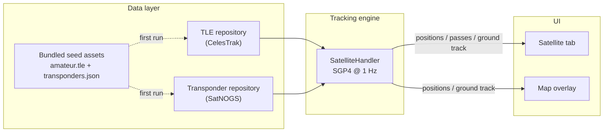

# Working the Birds: Amateur Satellite Support in HTCommander

*How HTCommander learned to track amateur radio satellites — computing where
every FM "easy sat" is right now, when it will next rise over you, and what
Doppler-shifted frequencies you'll need to work it. This post walks the whole
feature as it stands today: the orbital math, the two data sources that feed it,
the tab and the map overlay — and the honest ledger of what's still missing,
including a native radio command nobody has fully decoded yet.*

---

## What you can do today

Open the new **Satellite** tab and HTCommander shows you the amateur satellites
it can actually help you work: FM cross-band "repeater" birds like **SO-50**, the
**ISS** cross-band repeater, **PO-101**, **AO-91**, **LilacSat-2**, and the
**TEVEL** constellation. For each one you get:

- a **live list**, sorted so anything overhead floats to the top, with a
  countdown to the next pass and its maximum elevation;
- a **detail panel** for the selected bird — real-time azimuth/elevation, slant
  range, the sub-satellite point, altitude, and the **Doppler-corrected uplink
  and downlink frequencies** (plus the CTCSS tone needed to open the repeater);
- an **upcoming-passes** list with rise/set times, peak elevation, and the
  azimuths the satellite tracks across;
- a **3D globe** under the list (toggle it with *Show globe* in the tab menu, or
  use the globe button in the tab's title bar to let it fill the whole tab;
  while the radio is in Satellite mode only the tracked bird is drawn)
  showing your location, every bird with its current orbit, and a translucent
  **visibility cone** rising from your position at the minimum pass elevation
  (default 10°). Satellites inside the cone, and their orbits, turn **bold
  green**. Drag to rotate, scroll or pinch to zoom, click a satellite to select
  it (in the compact single-column layout, double-click it to open its
  details), and double-click empty space (or use the locate button) to
  recenter. Coastlines come
  from Natural Earth (public domain).

While a radio is tracking a satellite, the **Radio** tab swaps its channel grid
for a tracking panel in the same channel colors: a countdown to the next pass
(or, during a pass, until the bird sets), the live azimuth and elevation, plus
range, altitude and the Doppler-corrected uplink. Leaving satellite mode brings
the channels back.

Flip over to the **Map** tab and turn on *Show Satellites*: each bird is drawn at
its sub-point with its radio-horizon **footprint circle**, and the selected
satellite gets its **ground track** — the path it traces over the Earth for the
next ~50 minutes either side of now.

It works **offline on first run** (a small seed of orbital data ships in the
app) and quietly refreshes itself from the internet when it can.

One important honesty up front: these radios are **FM/AM only**. That means the
FM cross-band birds are fair game, but the **SSB/CW linear-transponder**
satellites (RS-44, FO-29, and friends) are *not* — the radio simply can't do the
mode. HTCommander filters the list down to birds you can really use.

---

## The shape of it

The feature is split into three layers, wired together over the app's internal
event bus (the "Data Broker"), exactly like every other HTCommander feature.



**Data layer.** Two small repositories load orbital elements and transponder
frequencies, each cached to disk with a bundled seed as the offline fallback.

**Tracking engine.** A background handler joins those two sources into a catalog
of workable FM birds, then once per second propagates each one and publishes its
position, look-angle, and Doppler. Pass predictions are computed when they need
to be (on a location change), not every tick.

**UI.** The tab and the map overlay are pure display + selection. They subscribe
to the handler's broadcasts and never do orbital math themselves.

---

## The orbital math: SGP4, without reinventing it

Satellites are tracked from **Two-Line Element sets (TLEs)** — the compact,
decades-old format that encodes an orbit as a handful of mean orbital elements.
You feed a TLE into the **SGP4** propagator (Simplified General Perturbations 4)
to get the satellite's position at any instant.

We did **not** hand-roll SGP4. It's a notoriously fiddly algorithm where small
mistakes produce plausible-but-wrong answers, so we lean on the pure-Dart
[`satellite_observer`](https://pub.dev/packages/satellite_observer) package. Per
satellite we build the propagator once and reuse it every tick (constructing it
runs the SGP4 initialisation, which isn't free):

```dart
final elements = GpElements.fromTle(tle.line1, tle.line2, name: tle.name);
final observer = SatelliteObserver(
  elements: elements,
  observer: Observer(latitudeDeg: lat, longitudeDeg: lon, altitudeMeters: alt),
);

final sub  = observer.subPointAt(now);   // lat/lon/alt beneath the satellite
final look = observer.lookAngleAt(now);  // az / el / range / range-rate
```

The observer's location comes from a connected **GPS** fix (or a manually set
position). We ignore sub-kilometre GPS jitter so a wandering fix doesn't force
the engine to rebuild every propagator once a second.

### Doppler, from range-rate

A low-Earth-orbit satellite closes on you at several km/s, so its signal arrives
Doppler-shifted — a few kHz on 2 m, up to ~10 kHz on 70 cm. `satellite_observer`
gives us the line-of-sight **range-rate** (positive when the satellite is
receding), which is all we need. With the speed of light *c*:

- **Downlink (what you receive):** tune to `downlink × (1 − range_rate / c)` — the
  signal is lower in frequency as the bird recedes.
- **Uplink (what you transmit):** pre-compensate to `uplink × (1 + range_rate / c)`
  so the satellite hears its nominal input frequency.

At AOS the bird is approaching (frequency high); at LOS it's receding (frequency
low). Today those corrected numbers are **displayed** in the tab so you can dial
them in by hand or spot the trend. Whether the app should push them to the radio
automatically is the interesting open question — more on that below.

---

## Where the data comes from

Two independent internet sources feed the feature, each answering a different
question.

### 1. Orbits — CelesTrak

Orbital elements come from **[CelesTrak](https://celestrak.org)**, the long-running
(since 1985) home of public GP/TLE data. We query the **amateur-radio group**:

```
https://celestrak.org/NORAD/elements/gp.php?GROUP=amateur&FORMAT=TLE
```

CelesTrak is a donation-funded non-profit, and it **aggressively firewalls
clients that abuse it** — re-downloading unchanged data will get your IP blocked.
Their data only updates every couple of hours, so our repository enforces a hard
rule: **never refetch if the cache is younger than two hours**, and treat any
non-200 response (a 301 redirect, a 403 block, a 404) as "stop, keep what we
have" rather than retrying in a loop. This is a correctness requirement, not an
optimisation.

### 2. Transponders — SatNOGS

A TLE tells you *where* a satellite is, not *what frequencies it uses*. For that
we use the **[SatNOGS DB](https://db.satnogs.org)** — a community-run database of
satellite transmitters:

```
https://db.satnogs.org/api/transmitters/?format=json
```

We keep only entries that are **active**, **FM**, and whose **uplink and downlink
both fall inside a band this radio can actually tune** (the 2 m and 70 cm FM
segments). That filter is what turns "every satellite in orbit" into "the handful
you can work with this handheld." SatNOGS doesn't carry CTCSS tones, so we carry
those over from our seed catalog for the well-known birds.

### 3. The offline seed

So the feature works on a first run with no internet, the app **bundles a seed**:
a small `amateur.tle` (real, recent elements for the marquee FM birds) and a
`transponders.json` frequency catalog. On first launch these load instantly;
the online refresh then quietly brings everything up to date.

---

## Verifying it

Orbital code is easy to get subtly wrong, so the feature ships with unit tests
that check the parts most likely to break: that the seed TLEs parse to the right
NORAD catalog numbers; that SGP4 puts the ISS at a plausible LEO altitude with a
valid look-angle; and that the Doppler math has the **right sign and magnitude**
(a receding bird lowers the downlink and raises the uplink; ~7 kHz of shift at
5 km/s on 70 cm). Against a known TLE and observer, the pass times and
azimuth/elevation line up with independent trackers like Gpredict and
Heavens-Above.

---

## Driving the radio: decoded, with a reception caveat

The original plan was to hand the satellite to the radio and let its firmware
compute the Doppler correction. Captures of the manufacturer app instead
revealed two complementary commands, now decoded and implemented:

- **`SET_SATELLITE_INFO` (77)** carries the satellite name and live look-angle
  metadata for the radio's display, not orbital elements or a Doppler schedule.
- **`FREQ_MODE_SET_PAR` (35)** sets the actual RX/TX frequencies, sub-audio and
  mode flags. HTCommander computes the Doppler correction and sends this command
  alongside the display update during tracking, subject to the retune mitigation
  below.

The payload layouts and captured examples are documented in
[the radio command protocol blog](radio-command-protocol.md#satellite-tracking-set_satellite_info-77--freq_mode_set_par-35).
The remaining problem is no longer decoding the commands: it is preserving
continuous reception while updating the tuning.

### Confirmed: frequency updates break received audio

**Manual testing on 2026-11-02 confirmed that `FREQ_MODE_SET_PAR` causes the
received Bluetooth audio breaks; `SET_SATELLITE_INFO` does not in the tested
setup.** Temporary independent Debug-tab toggles let each command be disabled separately.
With frequency updates sent every second, an ongoing transmission is split into
many roughly one-second recordings instead of one continuous clip.

This matters especially for **SSTV**, which needs a continuous receive stream:
HTCommander closes the current recording and finalizes active SSTV decoding
when the audio run ends. The command-level trigger is confirmed, but the precise
firmware mechanism and whether audio samples are lost or only stream boundaries
are introduced remain unverified. Behavior with unchanged frequencies also
remains unverified.

Those diagnostic toggles have now been removed. Both commands are always
enabled, regardless of previously saved toggle values. Use the Doppler settings
below to reduce retunes or hold tuning during reception.

### Mitigation: fewer retunes, or hold tuning during RX

Open **Satellite > Doppler settings...** to control the mitigation:

- **Retune threshold** defaults to **1000 Hz**. Once the three initial
  entry/settling frames have been sent, HTCommander sends a new tuning command
  only when RX or TX has drifted at least that far from the last sent frequency.
  Small per-second changes accumulate until the threshold is reached. Choose
  any frequency change, 500 Hz, 1000 Hz, or 2000 Hz. Unchanged tuning is skipped;
  satellite display metadata continues updating every second.
- **Hold Doppler updates while receiving** is **off by default**. When enabled,
  Bluetooth receive-audio activity defers periodic retunes until reception ends.
  Only the latest desired correction is considered then, subject to the
  threshold. Initial tuning and explicit satellite/usage, tone, or RX/TX
  availability changes still apply; remaining entry frames can wait until RX
  ends.

These settings apply globally, persist across launches, and take effect on the
next tracking tick. Deferred work is discarded when tracking stops, satellite
support is disabled, the radio unlocks, or it disconnects. The normal
stop-tracking command remains immediate unless disabled by the Debug toggle.

This is a mitigation, **not seamless retuning**: every tuning command can still
interrupt audio. The 1 kHz default is an experimental FM compromise that needs
hardware testing, not a guaranteed safe frequency error. Holding during a long
SSTV or voice transmission can let the satellite drift off frequency, especially
on UHF. Further work must establish how to update tuning without interrupting
continuous audio; simply joining recordings would not restore missing samples.

---

**Related:** [How a Benshi Radio Updates Its Firmware, Step by Step](benshi-firmware-update.md) ·
[A Channel You Can Text: The Channel-Share String](channel-share-string.md)
