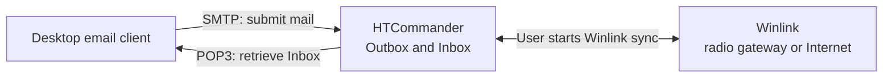

# Your Email Client, Your Radio: Local SMTP and POP3 for Winlink

*Compose Winlink messages in a familiar email client, while HTCommander handles
the mailbox, the queue, and the radio transport.*

**Status:** Implemented in the desktop builds of HTCommander, November 2026.
The servers are disabled by default and available on Windows, macOS, and Linux.

---

## The idea: keep the transport, choose the editor

HTCommander already sends and receives Winlink mail. Its built-in Mail tab is
useful when you want everything in one application, but people have established
email workflows: an address book, a preferred editor, local folders, and a way
of organizing messages that they already know.

Instead of making everyone change those habits, HTCommander can act as a small
**local email provider**. Your email client handles composing and reading.
HTCommander handles storing messages and exchanging them over Winlink.

This is not a new kind of radio protocol. There is a precedent in
[Winlink's Paclink](https://winlink.org/Paclink), which exposes SMTP and POP to
ordinary email clients. HTCommander's implementation follows that same basic
division of responsibilities.

The important distinction is where each protocol stops:

- **SMTP** submits a message from your email client to HTCommander.
- **POP3** retrieves received messages from HTCommander into your email client.
- **Winlink** exchanges queued and incoming messages through HTCommander's
  existing radio or Internet connection.

SMTP and POP3 stay on your computer. They do not become the over-the-air
transport.

## Turning it on

First configure your callsign and Winlink account in HTCommander as usual.
Then open **Settings > Servers**.

The local SMTP and POP3 servers have independent enable controls and port
fields. You can enable both for a complete send-and-receive account, or just
one if that fits your workflow.

| Server | Purpose | Default port |
|---|---|---|
| SMTP | Accept mail into HTCommander's Outbox | `8025` |
| POP3 | Retrieve mail from HTCommander's Inbox | `8110` |

Both are **off by default**. Saving settings applies the configuration without
requiring an application restart. Enabled servers start again when HTCommander
starts.

The default ports are deliberately above 1024, avoiding privileged-port
requirements on typical Unix systems and reducing conflicts with conventional
mail servers. Custom ports may range from 1 to 65535, but the operating system
must permit HTCommander to bind them. SMTP and POP3 cannot use the same port
when both are enabled.

Enabling either server generates a **mail bridge password** if one has not
already been configured. The same bridge credentials work for both protocols.
You can copy the password or generate a replacement in the Servers tab.

This is a separate password from your Winlink password. Your email client
authenticates to the local bridge; HTCommander authenticates to Winlink using
its existing Winlink settings. Changing the bridge password disconnects
existing email-client sessions.

## Adding the account to an email client

Create a separate, manually configured account rather than changing the SMTP
server of your everyday Internet email account. That keeps the sender identity
and transport choice clear.

Use the following settings, replacing `CALLSIGN` with your configured callsign:

| Client setting | Value |
|---|---|
| Email address | `CALLSIGN@winlink.org` |
| Incoming account type | POP3, not IMAP |
| Incoming server | `127.0.0.1` |
| Incoming port | `8110`, or your configured POP3 port |
| Outgoing SMTP server | `127.0.0.1` |
| Outgoing port | `8025`, or your configured SMTP port |
| Connection security | None, for both connections |
| Authentication | Normal password |
| Username | `CALLSIGN@winlink.org` |
| Password | The mail bridge password from Settings > Servers |

Enable authentication for the outgoing SMTP server as well as the incoming
server. The bare callsign is also accepted as a username.

If **Use station ID** is enabled in HTCommander's Winlink settings, include the
suffix in the account, for example `CALLSIGN-7@winlink.org`.

Thunderbird is a natural starting point because it exposes manual account,
port, and connection-security settings. Apple Mail on macOS also exposes manual
server settings; disable automatic connection-setting management where needed.
Account setup details vary by client and version.

Use **`127.0.0.1` explicitly**, rather than `localhost`. These servers listen on
IPv4 loopback; a client resolving `localhost` to IPv6 `::1` would be looking at
a different address.

Also configure the account to:

1. **Compose in plain text**, or include a plain-text alternative.
2. **Leave messages on the server** if you want them to remain in HTCommander's
   Inbox after downloading.
3. Use the Winlink sender address when composing messages for this account.

## What happens when you click Send?

Sending has two distinct stages.

### Stage 1: local submission

Your email client connects to HTCommander's SMTP server, authenticates, and
submits the message. HTCommander decodes the Internet email format into its
Winlink mail model and saves the message into **Outbox**.

The server acknowledges acceptance **only after persistent storage succeeds**.
If saving fails, it returns a temporary SMTP error so the client can retry.
An unsuccessful submission is not published into Outbox for a concurrent
Winlink session to pick up.

### Stage 2: Winlink transport

Start a Winlink connection from HTCommander's Mail tab, or select a Winlink
gateway on the map and choose **Sync mail**. The existing Winlink client
exchanges the queued messages and receives any available incoming mail.

Clicking Send in an email client does **not** automatically key the radio,
change its frequency, or initiate a Winlink connection. Likewise, an email
client polling POP3 checks the local Inbox; it does not initiate a radio session.

That separation lets you compose several messages first, then decide when and
how to synchronize.

> **"Sent" is not the same as "transmitted."** An email client may file a message
> in its own Sent folder as soon as SMTP accepts it. At that point, the message
> can still be waiting in HTCommander's Outbox. Check HTCommander for the
> Winlink transfer result; local SMTP acceptance is not an end-to-end delivery
> confirmation.

## Receiving mail and the POP3 deletion rules

Once a Winlink session places received messages in HTCommander's Inbox, your
email client can download them through POP3.

The bridge supplies stable **UIDL** identifiers derived from each message's
Winlink MID. A client that remembers those identifiers can recognize messages
it has already downloaded instead of downloading the same Inbox on every poll.

Each successful login gets an Inbox snapshot with consistent message numbers
for that session. Mail received afterward becomes available on the next login.
The server permits only **one authenticated POP3 session** to hold the maildrop
at a time.

Deletion follows POP3's transaction model:

- `DELE` marks a message for deletion within the session.
- `RSET` cancels those pending deletions.
- Disconnecting without `QUIT` leaves those messages in Inbox.
- A successful `QUIT` commits the deletions, moving the messages to
  HTCommander's **Trash** rather than permanently removing them.

This makes the client's "leave messages on the server" option important. A
client configured to delete mail after downloading will cause those messages
to move out of HTCommander's Inbox when it finishes the POP3 session.

POP3 is retrieval, not full mailbox synchronization. It does not expose
HTCommander's Draft, Outbox, Sent, Archive, or Trash folders, and it does not
synchronize read/unread flags. Local folders in your email client remain local
to that client.

## MIME meets Winlink

Ordinary email clients submit **MIME** messages: encoded headers, character-set
declarations, quoted-printable or base64 content, and multipart attachments.
Winlink B2F packages a plain-text body and attachment bytes differently.

The bridge converts between those representations using the
[enough_mail](https://pub.dev/packages/enough_mail) MIME library. It supports
encoded subjects, text character sets, and binary attachments. Addresses in
the `winlink.org` domain are mapped to Winlink callsigns for submission;
received callsigns are presented as email addresses for the desktop client.

There are deliberate limits:

| Content or behavior | Current handling |
|---|---|
| Plain-text messages | Supported |
| Multipart mail with a plain-text body | Supported |
| MIME attachments | Supported |
| HTML-only messages | Rejected; compose in plain text |
| Bcc | Rejected; no hidden-recipient representation in this bridge |
| Sender identity | Must match the configured Winlink account |
| SMTP message size | Maximum 10 MiB, including submitted MIME content |
| Subject | Maximum 252 UTF-8 bytes |

The server also checks that SMTP envelope recipients match the visible To and
Cc recipients. It does not silently convert a hidden recipient into a visible
one, or silently discard an HTML-only body.

The 10 MiB limit is a local submission ceiling, **not a recommendation for radio
email** or a guarantee that every Winlink path will accept that size. Keep
messages and attachments small. Radio airtime and remote-system limits still
matter.

## Why no TLS?

These servers listen only on **`127.0.0.1`**. They do not bind to Wi-Fi,
Ethernet, or all network interfaces, and there is no LAN-access setting.

For compatible desktop clients, plaintext SMTP and POP3 on loopback avoid the
certificate provisioning and trust setup that a local TLS service would
otherwise require. Authentication is still required, and the bridge password
is stored through HTCommander's platform-encrypted secret store. It is not
synchronized to hosted browsers or agents.

The boundary matters:

- This is a same-computer connection, not a server for other computers.
- Loopback does not authenticate the connecting application. Treat the bridge
  password as a credential and share it only with clients you trust.
- Do not try to expose the plaintext ports through forwarding or a network
  proxy.
- This feature does not add end-to-end encryption to Winlink radio mail.

TLS-backed LAN access would be a separate feature, with certificate trust,
network exposure, and additional client compatibility to address.

## Platform and client boundaries

| Platform | Local SMTP/POP3 hosting |
|---|---|
| Windows | Available |
| macOS | Available |
| Linux | Available |
| Android | Not exposed in this implementation |
| iOS / iPadOS | Not exposed in this implementation |
| Browser build | Not available |

HTCommander must remain running for a desktop email client to connect.
Supporting mobile hosting reliably would require additional lifecycle and
background-execution work. A browser cannot directly open these TCP listeners.

Another boundary is **where the email client connects from**. Some clients or
account configurations synchronize through a provider's cloud rather than
connecting directly from your computer. A cloud server cannot reach your
computer's `127.0.0.1`. Use a client configuration that makes direct local
connections; do not assume every modern Outlook or mobile-client configuration
will work simply because it advertises POP or SMTP support.

## What has been verified?

Automated socket tests exercise SMTP authentication, fragmented UTF-8 and MIME
input, attachment decoding, failed persistence, and acceptance/rejection at
the exact 10 MiB size boundary. POP3 tests cover MIME retrieval, advertised
octet counts, stable UIDL identifiers, header retrieval, authentication,
maildrop locking, and deletion transactions.

Settings tests cover disabled defaults, password generation, port validation,
and saving the controls. Lifecycle tests cover live port and password changes
and disconnecting existing sessions. Related mail persistence and Winlink
regression tests pass, and the browser build still compiles without the native
listeners.

Those checks establish the implemented protocol behavior. They are not a
claim that every email-client version has been manually tested, nor a new
over-the-air test of the existing Winlink transport.

## The useful split

This first implementation intentionally favors a small, local,
store-and-forward bridge over a complete mail-server stack. It gives an email
client a way to submit and retrieve Winlink messages while leaving radio
control and synchronization in HTCommander.

For one desktop client, SMTP plus POP3 is a useful fit. If the goal later becomes
shared folders, synchronized drafts, and several clients managing the same
mailbox, **IMAP** is the more appropriate next step.

For the current setup reference, see [Mail](../Mail.md). For the Winlink side,
see [the offline gateway directory](winlink-gateway-directory.md) and
[Winlink compression](winlink-gzip-compression.md).
