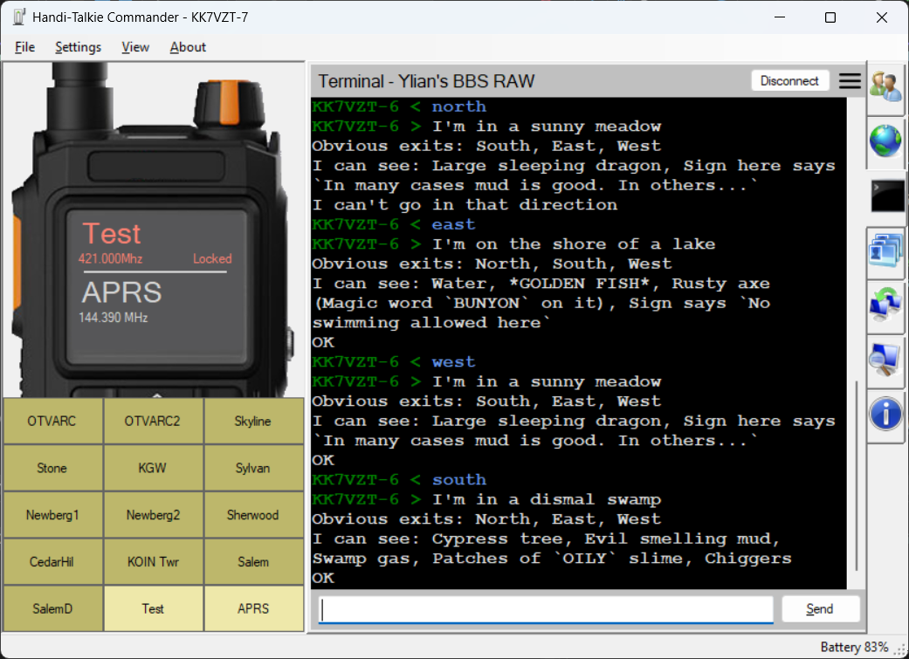

# Terminal

Like the older days of modems and BBS's, Handi-Talky Commander has a built-in Terminal allowing you to directly send and receive data to another endoint. This is super useful if you want to chat directly with other people or want to connect to a remote BBS. The terminal feature is only available to users to have a HAM radio license and send allow this application to transmit on the radio, otherwise, the terminal option is hidden.

To get started, just go on the terminal tab and hit connect on the upper right to add a new connection profile or connect to an existing one. You will need to specify the remote station and the type of protocol to use: Raw AX.25, Raw AX.25 (Compressed), APRS, AX.25 Session, XARA Narrow, or XARA Wide. You will also select on what channel to connect to. Once the profile is created, the radio will automatically be set to the right channel and "locked" to that channel until you disconnect the terminal or you change the channel on the radio itself.

## Connecting to a BBS using XARA

In the address book, add a **Terminal** contact with the BBS callsign (including its SSID), choose **XARA Narrow** or **XARA Wide** as the terminal protocol, and select the BBS channel/region. An optional digipeater path can contain up to two callsigns. XARA uses its own connected-mode protocol; no separate AX.25 modem selection is needed.

Enable the connected radio's audio, then choose this contact from **Connect** in the Terminal tab. Once the connection is established, enter BBS commands normally; each line is sent with a carriage return. **Disconnect** closes the XARA link and releases the radio lock. The selected bandwidth applies only to this connection, leaving the global XARA bandwidth preference unchanged. XARA requires the software-modem audio channel and is not available on web or iOS. YAPP file transfer and **Wait for Connection** currently use AX.25 sessions, not XARA.

If "Could not lock and tune" appears, XARA timed out after 15 seconds waiting for the local radio, before calling the remote station. The error includes the lock owner, expected and reported region/channel IDs (internal IDs, not display channel numbers), and a reason such as `lockNotHeld`, `lockOwnedByOtherUsage`, `statusUnavailable`, `regionMismatch`, or `channelMismatch`. Reported values are cached radio status, so a mismatch does not necessarily mean the radio is physically on the wrong channel. The debug log records the initial readiness state, changes while waiting, and any rejected lock request, including whether radio settings/status were available. `channelResolutionPending` means the contact's region/channel could not yet be resolved; the `resolution` field gives the resolver's result.

You should NOT use the terminal on the APRS channel. This is built to be used on other channels, however while using the terminal, the radio can monitor the APRS channel and still display incoming APRS messages. You can also send APRS messages while the terminal is connected and the main channel is locked.

If this something that is much better than the normal KISS protocol as this application can monitor and transmit on both APRS and Terminal channels and not be confused to as to which channel is which.
